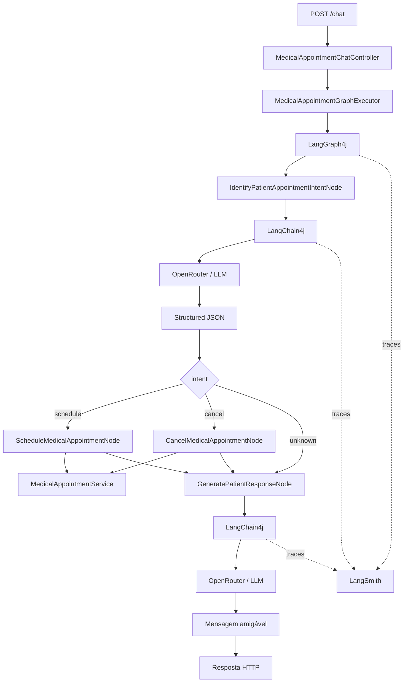

# poc_java_ia_consultamedica

POC didática em **Java 21 + Spring Boot** para estudar um workflow de Inteligência Artificial aplicado ao agendamento e cancelamento de consultas médicas fictícias.

O projeto é uma migração do exemplo JavaScript/TypeScript do **Módulo 03** para Java e foi organizado para alguém que já conhece desenvolvimento de software, mas ainda está aprendendo IA.

> **Importante:** este projeto é somente para estudo. Não use dados médicos reais.

---

## 1. O que eu queria aprender com este projeto?

A ideia principal é entender como transformar uma frase escrita por uma pessoa:

```text
Meu nome é Maria Santos.
Quero marcar uma consulta com o Dr. Alicio da Silva amanhã às 16h
para um check-up.
```

em dados que o Java consegue manipular de forma previsível:

```json
{
  "intent": "schedule",
  "professionalId": 1,
  "professionalName": "Dr. Alicio da Silva",
  "datetime": "2026-10-04T16:00:00Z",
  "patientName": "Maria Santos",
  "reason": "check-up"
}
```

Depois dessa transformação, a regra de negócio deixa de depender de linguagem natural.

Ela passa a trabalhar com campos conhecidos:

```text
intent = schedule
professionalId = 1
datetime = ...
patientName = Maria Santos
```

O fluxo fica:

```text
linguagem natural
      ↓
      IA
      ↓
JSON estruturado
      ↓
LangGraph4j State
      ↓
regra Java
      ↓
resultado técnico
      ↓
      IA
      ↓
mensagem amigável
```

---

# 2. Tecnologias

- Java 21
- Spring Boot 3.5.16
- Maven
- LangChain4j 1.20.2
- LangGraph4j 1.9.3
- LangGraph4j Studio
- OpenRouter
- LangSmith
- OpenTelemetry
- Jackson
- Bean Validation
- JUnit 5
- Postman

---

# 3. Visão geral da arquitetura



---

# 4. O que é IA neste projeto?

A IA não é responsável por toda a aplicação.

Ela é usada principalmente em duas partes.

## 4.1 Interpretar a frase do paciente

Entrada:

```text
Quero cancelar minha consulta com a Dra. Ana amanhã às 14h.
Meu nome é João.
```

Saída estruturada:

```json
{
  "intent": "cancel",
  "professionalId": 2,
  "professionalName": "Dra. Ana Pereira",
  "datetime": "2026-10-04T14:00:00Z",
  "patientName": "João"
}
```

## 4.2 Gerar a mensagem final

Depois que o Java executa a regra, o estado pode conter:

```json
{
  "intent": "schedule",
  "actionSucceeded": false,
  "actionError": "Horário indisponível para este profissional"
}
```

A IA transforma isso em algo amigável:

```text
Não foi possível agendar a consulta porque esse horário está indisponível.
Tente escolher outro horário.
```

---

# 5. O que a IA NÃO faz?

A IA não grava diretamente a consulta.

Ela não decide sozinha remover dados.

A ação real acontece no Java:

```text
MedicalAppointmentService
```

Métodos:

```java
scheduleMedicalAppointment(...)
cancelMedicalAppointment(...)
```

Isso é importante porque:

```text
IA interpreta
Java controla a regra de negócio
```

---

# 6. O que é uma LLM?

LLM significa **Large Language Model**.

É o modelo que recebe texto e consegue interpretar ou gerar linguagem.

Neste projeto, o modelo é acessado por meio do **OpenRouter**.

O modelo padrão configurado é:

```text
arcee-ai/trinity-large-preview:free
```

Como ele está no `.env`, é possível trocar sem alterar as classes Java.

---

# 7. OpenRouter

O OpenRouter é o serviço usado para acessar o modelo.

A chave:

```properties
OPENROUTER_API_KEY=...
```

serve para isso.

Fluxo:

```text
LangChain4j
     ↓
OpenRouter
     ↓
modelo de IA
```

Configuração:

```text
AiClientConfiguration
OpenRouterProperties
```

Endpoint padrão:

```text
https://openrouter.ai/api/v1
```

---

# 8. LangSmith

O **LangSmith não executa o modelo**.

Ele é usado para **observabilidade e tracing**.

A diferença é:

| Ferramenta | Função |
|---|---|
| OpenRouter | Executa/acessa o modelo |
| LangSmith | Registra e permite analisar traces |
| LangGraph4j | Controla o workflow |
| LangGraph4j Studio | Mostra o grafo localmente |

Então:

```properties
OPENROUTER_API_KEY
```

e:

```properties
LANGSMITH_API_KEY
```

têm finalidades diferentes.

---

# 9. Por que o projeto original tinha LANGSMITH_API_KEY?

O `.env.example` original possui:

```properties
LANGSMITH_API_KEY=your_langsmith_api_key_here
LANGCHAIN_TRACING_V2=true
LANGCHAIN_PROJECT=03-medical-appointment
```

Isso existe porque, no final da aula, o professor usa o **Trace** para observar a execução.

A versão Java preserva esse objetivo.

Como o ecossistema Java não é exatamente igual ao LangChain/LangGraph JavaScript, a implementação foi feita assim:

```text
LangGraph4j
   ↓
OpenTelemetry hooks
   ↓
OpenTelemetry SDK
   ↓
OTLP/HTTP
   ↓
LangSmith
```

E para as chamadas ao modelo:

```text
LangChain4j
   ↓
ChatModelListener
   ↓
OpenTelemetry span
   ↓
LangSmith
```

---

# 10. O que aparece no trace?

A estrutura esperada é parecida com:

```text
medical_appointments
│
├── identifyIntent
│    └── openrouter.chat
│
├── schedule
│
└── message
     └── openrouter.chat
```

ou:

```text
medical_appointments
│
├── identifyIntent
│    └── openrouter.chat
│
├── cancel
│
└── message
     └── openrouter.chat
```

Assim eu consigo observar:

- qual node rodou;
- qual caminho foi escolhido;
- quanto tempo cada etapa levou;
- quanto tempo a chamada ao modelo levou;
- erro do LLM;
- erro da regra de negócio;
- input/output do modelo, se configurado.

---

# 11. Variáveis do LangSmith

Na versão Java:

```properties
LANGSMITH_API_KEY=your_langsmith_api_key_here
LANGSMITH_TRACING=true
LANGSMITH_PROJECT=poc-java-ia-consultamedica
LANGSMITH_ENDPOINT=https://api.smith.langchain.com
LANGSMITH_INCLUDE_LLM_PAYLOADS=true
```

## LANGSMITH_API_KEY

Autentica o envio dos traces.

## LANGSMITH_TRACING

Liga ou desliga observabilidade.

```properties
LANGSMITH_TRACING=true
```

ou:

```properties
LANGSMITH_TRACING=false
```

A aplicação continua funcionando sem LangSmith.

## LANGSMITH_PROJECT

Nome do projeto que agrupa os traces.

## LANGSMITH_ENDPOINT

Endpoint base do LangSmith.

## LANGSMITH_INCLUDE_LLM_PAYLOADS

Quando `true`, o span da chamada ao LLM inclui prompt e saída.

```properties
LANGSMITH_INCLUDE_LLM_PAYLOADS=true
```

> Como este projeto é didático, todos os exemplos são fictícios. Em um sistema real com dados sensíveis, prompts e State precisariam de redaction e políticas adequadas.

---

# 12. Compatibilidade com as variáveis da aula

O projeto Java também entende as variáveis antigas do projeto JavaScript:

```properties
LANGCHAIN_TRACING_V2=true
LANGCHAIN_PROJECT=03-medical-appointment
```

Elas funcionam como fallback.

Mesmo assim, para o projeto Java prefira:

```properties
LANGSMITH_TRACING
LANGSMITH_PROJECT
```

---

# 13. LangGraph4j Studio

Além do LangSmith, o projeto possui o **LangGraph4j Studio**.

Depois de subir a aplicação, abra:

```text
http://localhost:3000/?instance=medical_appointments
```

Entrada do grafo:

```text
messages
```

No Studio você digita uma frase; a configuração Java converte esse texto para `List<String>`, preservando o conceito de `messages` do GraphState original.

Exemplo:

```text
Meu nome é Maria Santos e quero marcar uma consulta com o Dr. Alicio amanhã às 16h.
```

---

# 14. Studio e LangSmith são iguais?

Não.

## Studio

Ajuda a ver e executar o grafo localmente:

```text
START
  ↓
identifyIntent
  ↓
schedule/cancel/message
  ↓
message
  ↓
END
```

## LangSmith

Ajuda a analisar a execução:

```text
tempo
spans
inputs
outputs
chamadas ao LLM
erros
```

Neste projeto os dois estão presentes porque os dois ajudam a entender a aula.

---

# 15. O que é LangChain4j?

No projeto original é usado o ecossistema LangChain para JavaScript.

Na migração Java foi usado **LangChain4j**.

Ele faz a ponte entre o código Java e o modelo.

Exemplo conceitual:

```text
Java
 ↓
ChatRequest
 ↓
SystemMessage + UserMessage
 ↓
ResponseFormat + JsonSchema
 ↓
OpenRouter
```

Classes principais:

```text
AiClientConfiguration
OpenRouterStructuredOutputClient
OpenRouterPatientRequestInterpreter
OpenRouterPatientResponseGenerator
```

---

# 16. O que é Structured Output?

Sem Structured Output, eu poderia pedir:

```text
Responda em JSON.
```

Mas o modelo poderia retornar:

```text
Claro! Segue o JSON:

{
  ...
}
```

Isso é ruim para código.

O Structured Output envia um schema formal junto com a requisição.

Exemplo simplificado:

```json
{
  "type": "object",
  "properties": {
    "intent": {
      "enum": ["schedule", "cancel", "unknown"]
    },
    "professionalId": {
      "type": "integer"
    }
  },
  "required": ["intent"],
  "additionalProperties": false
}
```

No Java:

```text
MedicalAppointmentStructuredOutputSchemas
```

A chamada é feita por:

```text
OpenRouterStructuredOutputClient
```

---

# 17. O que substituiu o Zod?

O projeto JavaScript usa **Zod**.

Zod pertence ao ecossistema JavaScript/TypeScript.

Na versão Java a responsabilidade é dividida entre:

```text
LangChain4j JsonSchema
records Java
Bean Validation
validação do State antes da ação
```

Não faria sentido adicionar Zod ao Java.

---

# 18. Por que não existe um createAgent igual ao JavaScript?

Na aula o `createAgent` é usado como parte da implementação do Structured Output no ecossistema JavaScript.

Na migração Java, o mesmo objetivo é alcançado com:

```text
ChatModel
+
ChatRequest
+
ResponseFormat
+
JsonSchema
```

Eu preferi manter o conceito, e não copiar mecanicamente o nome de uma API.

O objetivo continua sendo:

```text
texto
 ↓
LLM
 ↓
objeto estruturado
```

---

# 19. JSON Prompt

Os prompts são organizados em JSON para facilitar leitura.

Exemplo conceitual:

```json
{
  "role": "Intent Classifier for Medical Appointments",
  "task": "Identify user intent",
  "professionals": [],
  "rules": {
    "schedule": {},
    "cancel": {},
    "unknown": {}
  }
}
```

Classes:

```text
MedicalAppointmentIntentPromptBuilder
PatientResponsePromptBuilder
```

---

# 20. System Prompt e User Prompt

## System Prompt

Define:

```text
papel
regras
profissionais
data atual
exemplos
```

## User Prompt

Contém:

```text
frase do paciente
instruções da tarefa
```

Separar os dois ajuda a organizar responsabilidades.

---

# 21. LangGraph4j

O LangGraph4j controla o workflow.

O grafo está em:

```text
MedicalAppointmentGraphConfiguration
```

Fluxo:

```text
START
  ↓
identifyIntent
  ↓
  ├── schedule → message → END
  ├── cancel   → message → END
  └── message  → END
```

---

# 22. State

O State é o conjunto de dados compartilhados entre os nodes.

Classe:

```text
MedicalAppointmentGraphState
```

Imagine uma mochila.

Ela começa assim:

```json
{
  "messages": [
    "Quero marcar uma consulta..."
  ]
}
```

Depois do primeiro node:

```json
{
  "messages": ["Quero marcar uma consulta..."],
  "intent": "schedule",
  "professionalId": 1,
  "professionalName": "Dr. Alicio da Silva",
  "appointmentDateTime": "...",
  "patientName": "Maria Santos",
  "reason": "check-up"
}
```

Depois da ação:

```json
{
  "...": "...",
  "actionSucceeded": true,
  "appointmentData": {
    "...": "..."
  }
}
```

---


## Por que `messages` existe?

O projeto TypeScript original inicializa o grafo com:

```text
messages: [HumanMessage(question)]
```

e o último node acrescenta a resposta da IA no mesmo histórico.

Na versão Java eu preservei esse conceito, mas usei:

```java
List<String>
```

em vez de objetos `BaseMessage`/`HumanMessage`.

Motivo:

```text
preservar o conceito da aula
+
manter o State simples
+
não acoplar o State a uma classe específica do provider
```

Ao final de uma requisição, `messages` fica conceitualmente assim:

```json
[
  "Quero marcar uma consulta amanhã às 16h.",
  "Sua consulta foi agendada com sucesso."
]
```

A POC continua sendo de **um turno por requisição**. Ela não implementa memória de conversas entre requests.

# 23. Nodes

## IdentifyPatientAppointmentIntentNode

Responsabilidade:

```text
frase humana
 ↓
IA
 ↓
Structured Output
 ↓
State
```

## ScheduleMedicalAppointmentNode

Executa quando:

```text
intent = schedule
```

Ele:

1. valida os dados necessários;
2. converte a data;
3. chama o serviço;
4. atualiza o State.

## CancelMedicalAppointmentNode

Executa quando:

```text
intent = cancel
```

## GeneratePatientResponseNode

É o último node.

Ele transforma o resultado técnico em texto amigável.

---

# 24. Conditional Edge

A classe:

```text
RoutePatientRequestByIntent
```

decide:

```java
schedule -> schedule
cancel   -> cancel
unknown  -> message
```

É assim que o grafo escolhe seu caminho.

---

# 25. "Confia, mas confere"

Mesmo que a IA retorne Structured Output, os nodes de ação validam os dados outra vez.

Classe:

```text
MedicalAppointmentActionStateValidator
```

Campos importantes:

```text
professionalId
appointmentDateTime
patientName
```

Isso preserva a ideia mostrada na aula:

```text
a etapa anterior validou?
ótimo.

a etapa atual ainda confere o que ela precisa.
```

---

# 26. Dados simulados

Profissionais:

| ID | Nome | Especialidade |
|---:|---|---|
| 1 | Dr. Alicio da Silva | Cardiologia |
| 2 | Dra. Ana Pereira | Dermatologia |
| 3 | Dra. Carol Gomes | Neurologia |

Agendamentos iniciais:

```text
hoje às 11:00 UTC
Dr. Alicio da Silva
Joao da Silva

amanhã às 14:00 UTC
Dra. Ana Pereira
Luana Costa
```

Tudo fica em memória.

---

# 27. Banco de dados

Não existe banco real.

Foi mantido assim por fidelidade ao projeto original e para não misturar assuntos.

Classe:

```text
InMemoryMedicalAppointmentRepository
```

Ao reiniciar:

```text
alterações são perdidas
```

---

# 28. Estrutura de pastas

```text
poc_java_ia_consultamedica/
│
├── .env.example
├── .gitignore
├── pom.xml
├── README.md
├── README_EN.md
│
├── docs/
│   └── ANALISE_MIGRACAO.md
│
├── postman/
│   └── poc_java_ia_consultamedica.postman_collection.json
│
└── src/
    ├── main/
    │   ├── java/br/com/vinicius/pocjavaiaconsultamedica/
    │   │   ├── ai/
    │   │   ├── api/
    │   │   ├── config/
    │   │   ├── domain/
    │   │   ├── graph/
    │   │   ├── observability/
    │   │   ├── repository/
    │   │   └── service/
    │   └── resources/
    │       └── application.yml
    └── test/
        └── java/...
```

---

# 29. Principais classes

| Classe | Responsabilidade |
|---|---|
| `MedicalAppointmentChatController` | Receber HTTP |
| `MedicalAppointmentGraphExecutor` | Iniciar o grafo |
| `MedicalAppointmentGraphConfiguration` | Declarar nodes e edges |
| `MedicalAppointmentGraphState` | Guardar State |
| `IdentifyPatientAppointmentIntentNode` | Interpretar a frase |
| `RoutePatientRequestByIntent` | Escolher o próximo node |
| `ScheduleMedicalAppointmentNode` | Agendar |
| `CancelMedicalAppointmentNode` | Cancelar |
| `GeneratePatientResponseNode` | Gerar resposta |
| `MedicalAppointmentService` | Regra de negócio |
| `InMemoryMedicalAppointmentRepository` | Persistência em memória |
| `OpenRouterStructuredOutputClient` | Chamada Structured Output |
| `MedicalAppointmentStructuredOutputSchemas` | JSON Schemas |
| `LangSmithOpenTelemetryConfiguration` | Exportar traces |
| `LangSmithChatModelTraceListener` | Trace das chamadas LLM |
| `LangGraphTracingConfiguration` | Hooks de trace do grafo |
| `LangGraphStudioConfiguration` | Expor Studio |

---

# 30. Intention-Revealing Names

Os nomes procuram explicar o que a classe ou método faz.

Exemplos:

```java
interpretPatientRequest(...)
processPatientQuestion(...)
scheduleMedicalAppointment(...)
cancelMedicalAppointment(...)
findMissingRequiredFields(...)
generatePatientResponse(...)
```

Evitei nomes genéricos como:

```text
execute()
process()
handle()
run()
```

quando havia um nome mais específico.

---

# 31. Pré-requisitos

Instale:

```text
JDK 21
Maven 3.9+
```

Confira:

```bash
java -version
mvn -version
```

---

# 32. Criando o .env

Copie:

```text
.env.example
```

para:

```text
.env
```

Linux/macOS:

```bash
cp .env.example .env
```

Windows PowerShell:

```powershell
Copy-Item .env.example .env
```

---

# 33. Configuração mínima: somente OpenRouter

Se você ainda não quiser usar LangSmith:

```properties
OPENROUTER_API_KEY=sua_chave
OPENROUTER_MODEL=arcee-ai/trinity-large-preview:free

LANGSMITH_TRACING=false
```

O projeto funciona normalmente.

---

# 34. Configuração completa: OpenRouter + LangSmith

```properties
OPENROUTER_API_KEY=sua_chave_openrouter
OPENROUTER_BASE_URL=https://openrouter.ai/api/v1
OPENROUTER_MODEL=arcee-ai/trinity-large-preview:free
OPENROUTER_TEMPERATURE=0.7

LANGSMITH_API_KEY=sua_chave_langsmith
LANGSMITH_TRACING=true
LANGSMITH_PROJECT=poc-java-ia-consultamedica
LANGSMITH_ENDPOINT=https://api.smith.langchain.com
LANGSMITH_INCLUDE_LLM_PAYLOADS=true
```

---

# 35. Por que a temperatura é 0.7?

O projeto JavaScript original usa:

```text
0.7
```

Na primeira migração eu havia colocado um valor menor por preferência de determinismo.

Na revisão final isso foi corrigido.

A versão atual mantém:

```properties
OPENROUTER_TEMPERATURE=0.7
```

por fidelidade ao projeto analisado.

---

# 36. Executando os testes locais

```bash
mvn clean test
```

Os testes normais:

- não precisam de LangSmith;
- não precisam chamar OpenRouter;
- testam o grafo e a regra de negócio de forma determinística.

---

# 37. Executando o E2E real com OpenRouter

O teste externo precisa de:

```text
OPENROUTER_API_KEY
```

e de opt-in explícito:

```bash
mvn -DrunOpenRouterE2E=true \
    -Dtest=OpenRouterMedicalAppointmentE2ETest \
    test
```

Assim `mvn test` não começa a gastar chamadas externas por acidente.

---

# 38. Subindo a aplicação

```bash
mvn spring-boot:run
```

Porta:

```text
3000
```

---

# 39. Endpoint original

A versão Java preserva:

```text
POST /chat
```

Body:

```json
{
  "question": "Meu nome é Maria Santos e quero uma consulta com o Dr. Alicio da Silva amanhã às 16h"
}
```

Também existe o alias:

```text
POST /api/medical-appointments/chat
```

Ele foi adicionado por clareza, sem remover o endpoint da aula.

---

# 40. Exemplo com cURL

```bash
curl --request POST \
  --url http://localhost:3000/chat \
  --header 'Content-Type: application/json' \
  --data '{
    "question": "Meu nome é Maria Santos e quero uma consulta com o Dr. Alicio da Silva amanhã às 16h para um check-up"
  }'
```

---

# 41. Estrutura da resposta

Exemplo:

```json
{
  "messages": [
    "Meu nome é Maria Santos e quero uma consulta...",
    "Sua consulta foi agendada com sucesso..."
  ],
  "intent": "schedule",
  "professionalId": 1,
  "professionalName": "Dr. Alicio da Silva",
  "datetime": "2026-10-04T16:00:00Z",
  "patientName": "Maria Santos",
  "reason": "check-up",
  "actionSuccess": true,
  "actionError": null,
  "error": null,
  "processingError": null,
  "appointmentData": {
    "dateTime": "2026-10-04T16:00:00Z",
    "patientName": "Maria Santos",
    "reason": "check-up",
    "professionalId": 1
  },
  "message": "..."
}
```

---

# 42. actionError e processingError

## actionError

Erro da regra:

```text
Horário indisponível
Consulta não encontrada
```

## processingError

Erro no processamento técnico/IA:

```text
OpenRouter indisponível
Structured Output inválido
```

O campo:

```text
error
```

é mantido como alias de `processingError` para deixar a resposta mais próxima do State do projeto original.

---

# 43. Postman

Arquivo:

```text
postman/poc_java_ia_consultamedica.postman_collection.json
```

Possui:

1. agendamento com sucesso;
2. horário ocupado;
3. criação para cancelamento;
4. cancelamento da consulta criada;
5. cancelamento inexistente;
6. intenção desconhecida;
7. teste do alias REST.

Nos cenários 3 e 4, execute na ordem.

---

# 44. Como acompanhar pelo LangGraph4j Studio

Com a aplicação rodando:

```text
http://localhost:3000/?instance=medical_appointments
```

Informe:

```text
messages
```

No campo `messages`, digite a frase do paciente. A configuração do Studio converte o texto em `List<String>` para preservar o conceito do `GraphState` original.

Depois, execute o grafo.

Isso ajuda a enxergar:

```text
START
 ↓
identifyIntent
 ↓
schedule/cancel/message
 ↓
message
 ↓
END
```

---

# 45. Como acompanhar pelo LangSmith

Configure:

```properties
LANGSMITH_API_KEY=...
LANGSMITH_TRACING=true
LANGSMITH_PROJECT=poc-java-ia-consultamedica
```

Execute um request.

Depois abra o projeto correspondente no LangSmith.

Procure o trace:

```text
medical_appointments
```

Ele deve conter spans do grafo e das chamadas ao OpenRouter.

---

# 46. Se eu não quiser enviar prompt/saída ao trace

Use:

```properties
LANGSMITH_INCLUDE_LLM_PAYLOADS=false
```

Isso evita que o listener de chamadas ao modelo adicione `input.value` e `output.value`.

> O grafo ainda pode produzir atributos de State nos spans. Para dados realmente sensíveis, a estratégia correta é projetar redaction completa, e não somente desligar esse campo.

---

# 47. O que foi estudado em cada transcrição?

## MÓDULO 03 - 01
### Identificando intenção e introdução ao projeto

Conceitos:

- entrada em linguagem natural;
- intenção;
- `schedule`;
- `cancel`;
- `unknown`;
- State;
- nodes;
- edges;
- conditional edges;
- profissionais;
- consultas em memória.

Correspondência Java:

```text
MedicalAppointmentGraphState
MedicalAppointmentIntent
MedicalAppointmentGraphConfiguration
MedicalProfessionalDirectory
InMemoryMedicalAppointmentRepository
```

---

# 48. MÓDULO 03 - 02
## Structured JSON, JSON Prompts e OpenRouter

Conceitos:

- saída estruturada;
- schema;
- prompts JSON;
- OpenRouter;
- modelo;
- provider;
- temperatura;
- transformação da resposta da IA em objeto.

Correspondência Java:

```text
AiClientConfiguration
MedicalAppointmentStructuredOutputSchemas
OpenRouterStructuredOutputClient
MedicalAppointmentIntentPromptBuilder
OpenRouterPatientRequestInterpreter
```

JavaScript:

```text
Zod
ChatOpenAI
providerStrategy
```

Java:

```text
JsonSchema
OpenAiChatModel
ResponseFormat
```

---

# 49. MÓDULO 03 - 03
## Intenção em JSON e primeiro E2E

Conceitos:

```text
question
 ↓
prompt
 ↓
LLM
 ↓
JSON
 ↓
State
 ↓
routing
```

Correspondência Java:

```text
IdentifyPatientAppointmentIntentNode
RoutePatientRequestByIntent
MedicalAppointmentGraphExecutor
MedicalAppointmentChatController
MedicalAppointmentGraphFlowTest
OpenRouterMedicalAppointmentE2ETest
```

---

# 50. MÓDULO 03 - 04
## Cancelamento, validação, E2E, Studio e Trace

Conceitos:

- segunda validação;
- schedule;
- cancel;
- action success/error;
- mensagem final;
- último E2E;
- LangGraph Studio;
- Trace;
- configuração de tracing.

Correspondência Java:

```text
MedicalAppointmentActionStateValidator
ScheduleMedicalAppointmentNode
CancelMedicalAppointmentNode
GeneratePatientResponseNode
LangGraphStudioConfiguration
LangGraphTracingConfiguration
LangSmithOpenTelemetryConfiguration
LangSmithChatModelTraceListener
```

Essa aula é o motivo pelo qual a versão corrigida inclui LangSmith de forma funcional.

---

# 51. Mapeamento JavaScript → Java

| JavaScript | Java |
|---|---|
| `src/server.ts` | `MedicalAppointmentChatController` |
| `src/graph/graph.ts` | `MedicalAppointmentGraphState` |
| `src/graph/factory.ts` | `MedicalAppointmentGraphConfiguration` |
| `identifyIntentNode.ts` | `IdentifyPatientAppointmentIntentNode` |
| `schedulerNode.ts` | `ScheduleMedicalAppointmentNode` |
| `cancellerNode.ts` | `CancelMedicalAppointmentNode` |
| `messageGeneratorNode.ts` | `GeneratePatientResponseNode` |
| `appointmentService.ts` | `MedicalAppointmentService` + Repository |
| `openRouterService.ts` | `OpenRouterStructuredOutputClient` |
| `identifyIntent.ts` | Prompt Builder + Schema |
| `messageGenerator.ts` | Prompt Builder + Schema |
| Zod | LangChain4j JsonSchema |
| LangChain JS | LangChain4j |
| LangGraph JS | LangGraph4j |
| `langgraph.json` / Studio | `LangGraphStudioConfiguration` |
| LangChain tracing env | OpenTelemetry + LangSmith |

---

# 52. Correções feitas em relação ao original

A migração não copia defeitos apenas para ficar idêntica.

Foram corrigidos:

- README original com conteúdo de outro projeto;
- `catch` que poderia retornar `success: true`;
- tratamento inconsistente de erros;
- prompt final que pedia idioma do paciente sem receber a pergunta original;
- separação mais clara entre erro técnico e erro de negócio.

---

# 53. Melhorias didáticas adicionadas

Além da equivalência:

- nomes Intention-Revealing;
- comentários;
- interfaces para desacoplar IA;
- teste de regra sem chamar LLM;
- Postman;
- README PT;
- README EN;
- auditoria da migração;
- alias REST mais explícito;
- configuração para ligar/desligar tracing.

---

# 54. Por que usar interfaces para IA?

Interfaces:

```text
PatientRequestInterpreter
PatientResponseGenerator
```

Implementações:

```text
OpenRouterPatientRequestInterpreter
OpenRouterPatientResponseGenerator
```

Nos testes, eu posso substituir a IA por respostas previsíveis.

Assim eu consigo testar:

```text
LangGraph4j
+
regra Java
```

sem internet e sem custo.

---

# 55. Ordem recomendada para estudar o código

Eu estudaria assim:

```text
1. MedicalAppointmentChatController
2. MedicalAppointmentGraphExecutor
3. MedicalAppointmentGraphConfiguration
4. MedicalAppointmentGraphState
5. IdentifyPatientAppointmentIntentNode
6. MedicalAppointmentIntentPromptBuilder
7. MedicalAppointmentStructuredOutputSchemas
8. OpenRouterStructuredOutputClient
9. RoutePatientRequestByIntent
10. ScheduleMedicalAppointmentNode
11. CancelMedicalAppointmentNode
12. MedicalAppointmentService
13. GeneratePatientResponseNode
14. LangGraphStudioConfiguration
15. LangGraphTracingConfiguration
16. LangSmithOpenTelemetryConfiguration
17. LangSmithChatModelTraceListener
```

---

# 56. Problemas comuns

## OPENROUTER_API_KEY não configurada

Erro na inicialização.

Solução:

```properties
OPENROUTER_API_KEY=...
```

## LangSmith habilitado sem chave

Se:

```properties
LANGSMITH_TRACING=true
```

configure:

```properties
LANGSMITH_API_KEY=...
```

ou desligue:

```properties
LANGSMITH_TRACING=false
```

## Trace não aparece imediatamente

O exporter usa batch.

Faça uma requisição completa e confira o projeto configurado em:

```properties
LANGSMITH_PROJECT
```

## Modelo gratuito indisponível/rate limit

O modelo do OpenRouter é externo e pode ter limite ou disponibilidade variável.

Troque:

```properties
OPENROUTER_MODEL=...
```

por outro modelo compatível com Structured Output.

## Data relativa diferente

"hoje" e "amanhã" dependem da data atual enviada no prompt.

---

# 57. Segurança e privacidade

Nunca versione:

```text
.env
```

O `.gitignore` já ignora esse arquivo.

Nunca coloque:

```text
OPENROUTER_API_KEY real
LANGSMITH_API_KEY real
```

no repositório.

Não envie dados médicos reais para esta POC.

---

# 58. Limitações

Não possui:

- autenticação;
- autorização;
- banco persistente;
- LGPD real;
- prontuário;
- timezone completo por paciente;
- concorrência distribuída;
- idempotência;
- retry avançado;
- circuit breaker;
- confirmação humana antes do cancelamento;
- controle de duração das consultas.

Esses itens não fazem parte da ideia principal das aulas.

---

# 59. Auditoria da migração

Leia:

```text
docs/ANALISE_MIGRACAO.md
```

Esse arquivo contém a comparação item por item entre:

```text
projeto JavaScript
transcrições
projeto Java
```

---

# 60. Resumo final

Em uma frase:

> A IA entende a linguagem humana; o LangGraph4j organiza o caminho; o Java executa a regra; o LangSmith ajuda a enxergar o que aconteceu.

Fluxo:

```text
paciente
  ↓
texto
  ↓
LLM
  ↓
Structured JSON
  ↓
State
  ↓
conditional edge
  ↓
Java
  ↓
State
  ↓
LLM
  ↓
mensagem
```

E, paralelamente:

```text
workflow + chamadas LLM
          ↓
     OpenTelemetry
          ↓
       LangSmith
```

---

# Referências técnicas

- LangChain4j: https://docs.langchain4j.dev/
- Structured Outputs: https://docs.langchain4j.dev/tutorials/structured-outputs/
- LangGraph4j: https://github.com/langgraph4j/langgraph4j
- OpenRouter: https://openrouter.ai/docs
- LangSmith: https://docs.langchain.com/langsmith/
- OpenTelemetry Java: https://opentelemetry.io/docs/languages/java/
- Spring Boot: https://spring.io/projects/spring-boot
