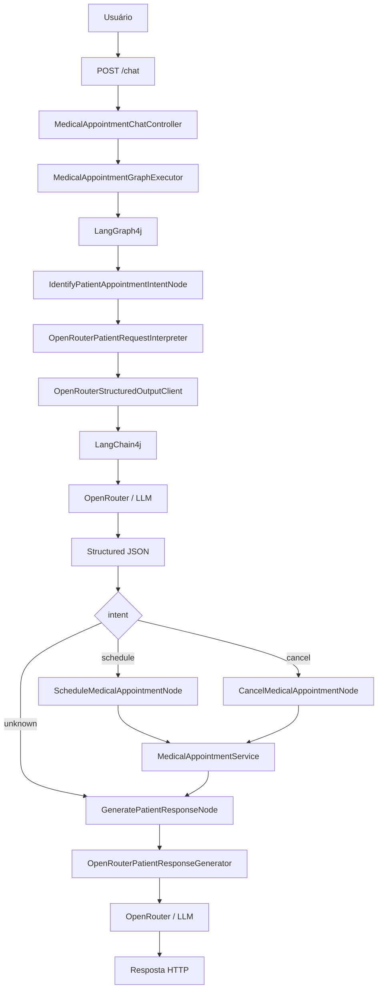

# poc_java_ia_consultamedica

POC didática em **Java 21 + Spring Boot** para aprender, passo a passo, como uma aplicação Java pode usar IA para **entender linguagem natural**, transformar essa informação em **dados estruturados** e executar uma regra de negócio previsível.

O domínio escolhido é simples: **agendar e cancelar consultas médicas fictícias**.

> **Este é um projeto de estudo. Não use dados médicos reais.**

---

# 1. O que você deve aprender ao terminar este README

Não quero que você apenas consiga executar o projeto.

O objetivo é que, depois de estudar este material, você consiga explicar com suas próprias palavras:

1. o que é uma LLM;
2. o que é um prompt;
3. a diferença entre `SystemMessage` e `UserMessage`;
4. por que usamos Structured Output;
5. o que é JSON Schema;
6. para que serve o LangChain4j;
7. para que serve o OpenRouter;
8. o que é um State;
9. o que é um Node;
10. o que é uma Edge;
11. o que é uma Conditional Edge;
12. como o LangGraph4j controla o workflow;
13. por que a IA não deve executar diretamente a regra de negócio;
14. para que servem LangGraph4j Studio, LangSmith e OpenTelemetry;
15. como construir outro projeto usando a mesma arquitetura.

Se você conseguir responder esses 15 itens sem consultar o README, o projeto cumpriu seu objetivo didático.

---

# 2. O problema que estamos resolvendo

Um sistema Java trabalha melhor com dados conhecidos.

Por exemplo:

```java
long professionalId = 1L;
String patientName = "Maria Santos";
Instant dateTime = ...;
```

Mas pessoas não conversam assim.

Uma pessoa escreve:

```text
Olá, meu nome é Maria Santos.
Quero marcar uma consulta com o Dr. Alicio amanhã às 16h
porque preciso fazer um check-up.
```

O Java não sabe naturalmente que:

```text
"marcar uma consulta" = intenção de agendar
"Dr. Alicio"          = professionalId 1
"amanhã às 16h"       = uma data/hora
"Maria Santos"        = nome do paciente
"check-up"            = motivo
```

É aqui que a IA entra.

Ela faz a ponte entre:

```text
LINGUAGEM HUMANA
       ↓
      IA
       ↓
DADOS ESTRUTURADOS
```

Depois dessa etapa, o restante pode continuar sendo Java tradicional.

---

# 3. A ideia principal do projeto

O projeto **não usa IA para tudo**.

Ele divide responsabilidades.

```text
Pessoa escreve uma frase
          ↓
IA interpreta a frase
          ↓
Structured Output
          ↓
Dados entram no State
          ↓
LangGraph4j escolhe o fluxo
          ↓
Java executa a regra de negócio
          ↓
Resultado volta para o State
          ↓
IA gera uma mensagem amigável
          ↓
Resposta HTTP
```

A frase mais importante deste projeto é:

> **A IA interpreta o que é flexível; o Java controla o que precisa ser determinístico.**

---

# 4. Antes de continuar: 8 conceitos básicos

## 4.1 LLM

LLM significa **Large Language Model**.

Neste projeto, ela recebe texto e ajuda a extrair significado.

Exemplo:

```text
Quero cancelar a consulta que tenho amanhã às 14h com a Dra. Ana.
Meu nome é João.
```

A LLM pode transformar isso em:

```json
{
  "intent": "cancel",
  "professionalId": 2,
  "professionalName": "Dra. Ana Pereira",
  "datetime": "2026-10-04T14:00:00Z",
  "patientName": "João"
}
```

A LLM não é:

- banco de dados;
- controller;
- regra de negócio;
- repositório.

Neste projeto ela é principalmente um **interpretador de linguagem**.

---

## 4.2 Prompt

Prompt é a informação enviada ao modelo.

Um prompt pode explicar:

```text
quem o modelo deve ser;
qual tarefa deve executar;
quais regras deve seguir;
quais dados estão disponíveis;
qual formato de resposta esperamos.
```

Neste projeto existem classes específicas para montar prompts:

```text
MedicalAppointmentIntentPromptBuilder
PatientResponsePromptBuilder
```

Isso é melhor do que espalhar Strings gigantes pelo código.

---

## 4.3 System Message

A `SystemMessage` fornece o contexto e as regras principais.

Exemplo conceitual:

```text
Você é um classificador de intenções.
As intenções permitidas são:
- schedule
- cancel
- unknown

Estes são os profissionais disponíveis...
```

Ela define **como o modelo deve trabalhar**.

---

## 4.4 User Message

A `UserMessage` contém a entrada que deve ser processada.

Exemplo:

```text
Meu nome é Maria e quero uma consulta amanhã às 16h.
```

Resumindo:

```text
SystemMessage → regras da tarefa
UserMessage   → dado que será analisado
```

---

## 4.5 Structured Output

Structured Output significa pedir ao modelo uma resposta com **estrutura definida**.

Não queremos:

```text
Claro! Eu entendi que Maria quer marcar uma consulta...
```

Queremos algo que o Java consiga transformar em objeto:

```json
{
  "intent": "schedule",
  "patientName": "Maria"
}
```

A documentação atual do LangChain4j recomenda JSON Schema como a opção mais confiável entre as formas de obter saída estruturada quando o provider/modelo suporta esse recurso.

---

## 4.6 JSON Schema

JSON Schema descreve **como o JSON deve ser**.

Exemplo simplificado:

```json
{
  "type": "object",
  "properties": {
    "intent": {
      "enum": ["schedule", "cancel", "unknown"]
    },
    "patientName": {
      "type": "string"
    }
  },
  "required": ["intent"]
}
```

Isso diz:

```text
intent:
  deve existir
  e só pode ser schedule, cancel ou unknown

patientName:
  deve ser String, se informado
```

No projeto, os schemas ficam em:

```text
MedicalAppointmentStructuredOutputSchemas
```

---

## 4.7 Workflow

Workflow é o **caminho da aplicação**.

Exemplo:

```text
identificar intenção
       ↓
   é schedule?
       ↓
   agendar
       ↓
gerar mensagem
```

ou:

```text
identificar intenção
       ↓
    é cancel?
       ↓
   cancelar
       ↓
gerar mensagem
```

O LangGraph4j foi usado para deixar esse fluxo explícito.

---

## 4.8 Observabilidade

Observabilidade ajuda a responder perguntas como:

```text
Qual Node executou?
Qual caminho o grafo escolheu?
Quanto tempo a chamada à IA demorou?
Qual erro aconteceu?
Qual modelo respondeu?
```

Neste projeto:

```text
LangGraph4j Studio → visualiza o grafo localmente
LangSmith          → analisa traces
OpenTelemetry      → transporta os spans/traces
```

---

# 5. Mapa mental das tecnologias

| Tecnologia | Responsabilidade |
|---|---|
| Java 21 | linguagem principal |
| Spring Boot | aplicação e API REST |
| Bean Validation | valida entrada HTTP |
| LangChain4j | comunicação Java ↔ LLM |
| OpenRouter | acesso ao modelo |
| Jackson | JSON ↔ objetos Java |
| LangGraph4j | workflow baseado em State, Nodes e Edges |
| LangGraph4j Studio | inspeção visual do grafo |
| LangSmith | observabilidade |
| OpenTelemetry | criação/exportação de traces |
| JUnit | testes |
| Postman | chamadas manuais à API |

Uma forma curta de memorizar:

```text
Spring       → recebe a requisição
LangChain4j  → fala com a IA
OpenRouter   → entrega acesso ao modelo
LangGraph4j  → organiza o caminho
Java Service → executa a regra
LangSmith    → mostra o que aconteceu
```

---

# 6. Visão arquitetural



Observe que existem **duas chamadas à IA** no fluxo normal de schedule/cancel:

```text
1ª chamada → entender a intenção
2ª chamada → gerar a mensagem amigável
```

A operação de agendar/cancelar fica no meio e é executada por Java.

---

# 7. O coração do projeto: o State

A documentação do LangGraph4j define `AgentState` como o estado compartilhado do grafo: cada Node recebe o State atual e devolve atualizações para ele.

Neste projeto:

```text
MedicalAppointmentGraphState
```

é a classe que representa esse estado.

## 7.1 Pense no State como uma mochila

No início da viagem:

```json
{
  "messages": [
    "Meu nome é Maria e quero uma consulta amanhã às 16h."
  ]
}
```

O primeiro Node coloca novas informações na mochila:

```json
{
  "messages": [
    "Meu nome é Maria e quero uma consulta amanhã às 16h."
  ],
  "intent": "schedule",
  "professionalId": 1,
  "professionalName": "Dr. Alicio da Silva",
  "datetime": "2026-10-04T16:00:00Z",
  "patientName": "Maria"
}
```

O Node de agendamento adiciona:

```json
{
  "...": "...",
  "actionSuccess": true,
  "appointmentData": {
    "professionalId": 1,
    "patientName": "Maria",
    "dateTime": "2026-10-04T16:00:00Z"
  }
}
```

O último Node adiciona a mensagem final:

```json
{
  "messages": [
    "Meu nome é Maria e quero uma consulta amanhã às 16h.",
    "Sua consulta foi agendada com sucesso."
  ],
  "...": "..."
}
```

## 7.2 Por que isso é útil?

Porque os Nodes não precisam passar dezenas de parâmetros diretamente uns para os outros.

Eles compartilham um contexto comum:

```text
Node A
 ↓
State
 ↓
Node B
 ↓
State
 ↓
Node C
```

---

# 8. Nodes: cada etapa tem uma responsabilidade

A documentação do LangGraph4j descreve Nodes como os blocos que recebem o State, executam uma ação e devolvem atualizações do State.

Neste projeto existem quatro Nodes principais.

---

## 8.1 IdentifyPatientAppointmentIntentNode

Objetivo:

> descobrir o que o paciente quer e extrair os dados da frase.

Entrada:

```text
state.messages[0]
```

Exemplo:

```text
"Quero marcar com o Dr. Alicio amanhã às 16h. Meu nome é Maria."
```

O Node chama:

```text
PatientRequestInterpreter
```

Implementação real:

```text
OpenRouterPatientRequestInterpreter
```

Resultado esperado:

```json
{
  "intent": "schedule",
  "professionalId": 1,
  "professionalName": "Dr. Alicio da Silva",
  "datetime": "...",
  "patientName": "Maria"
}
```

O Node então copia essas informações para o State.

### O que aprender aqui?

Esse Node mostra a fronteira:

```text
texto não estruturado
        ↓
       IA
        ↓
dados estruturados
```

---

## 8.2 ScheduleMedicalAppointmentNode

Executado quando:

```text
intent = schedule
```

Antes de agendar:

```text
MedicalAppointmentActionStateValidator
```

confere se existem:

```text
professionalId
datetime
patientName
```

Depois chama:

```text
MedicalAppointmentService.scheduleMedicalAppointment(...)
```

### O que aprender aqui?

A IA já terminou seu trabalho de interpretação.

A partir daqui:

```text
Instant.parse(...)
if (horário ocupado)
repository.save(...)
```

é Java normal.

---

## 8.3 CancelMedicalAppointmentNode

Executado quando:

```text
intent = cancel
```

Ele:

```text
valida os campos
      ↓
converte datetime
      ↓
chama MedicalAppointmentService
      ↓
procura a consulta
      ↓
remove se encontrar
```

Novamente, a IA não cancela diretamente.

---

## 8.4 GeneratePatientResponseNode

Esse é o Node final.

Ele pega um State técnico:

```json
{
  "intent": "schedule",
  "actionSuccess": false,
  "actionError": "Horário indisponível"
}
```

e solicita uma mensagem adequada.

Exemplo:

```text
Não foi possível realizar o agendamento porque esse horário está indisponível.
```

Se essa chamada à IA falhar, existe um **fallback determinístico** em Java.

Isso significa:

```text
IA falhou
   ↓
Java ainda consegue devolver uma mensagem básica
```

---

# 9. Edges e Conditional Edges

## 9.1 Edge normal

Uma Edge normal significa:

> depois desse Node, sempre vá para aquele Node.

Exemplo:

```text
schedule → message
cancel   → message
message  → END
```

---

## 9.2 Conditional Edge

Uma Conditional Edge escolhe o próximo destino dinamicamente.

No projeto:

```text
RoutePatientRequestByIntent
```

analisa:

```text
state.intent
```

e decide:

```text
schedule → schedule
cancel   → cancel
unknown  → message
```

Visualmente:

```text
                 ┌─ schedule ─┐
identifyIntent ──┼─ cancel ───┼→ message → END
                 └─ unknown ──┘
```

A documentação oficial do LangGraph4j destaca exatamente esse uso: Conditional Edges são usadas quando o próximo Node depende do State atual.

---

# 10. Como o grafo é montado

Classe:

```text
MedicalAppointmentGraphConfiguration
```

Ela define:

```text
Nodes
Edges
Conditional Edges
START
END
```

Conceitualmente:

```java
addNode("identifyIntent", ...)
addNode("schedule", ...)
addNode("cancel", ...)
addNode("message", ...)

addEdge(START, "identifyIntent")

addConditionalEdges(
    "identifyIntent",
    ...
)

addEdge("schedule", "message")
addEdge("cancel", "message")
addEdge("message", END)
```

Depois o `StateGraph` é compilado para virar um grafo executável.

Segundo a documentação do LangGraph4j, a compilação transforma a definição em um `CompiledGraph`, que pode então ser invocado.

---

# 11. Raio-X de uma requisição completa

Agora vamos acompanhar uma requisição real conceitualmente.

Entrada:

```json
{
  "question": "Meu nome é Maria Santos e quero uma consulta com o Dr. Alicio da Silva amanhã às 16h para um check-up"
}
```

---

## Passo 1 — Controller

Classe:

```text
MedicalAppointmentChatController
```

Responsabilidade:

```text
receber HTTP
validar request
chamar o executor
devolver response
```

Ele não sabe detalhes de IA.

Isso é proposital.

---

## Passo 2 — Executor cria a entrada do grafo

Classe:

```text
MedicalAppointmentGraphExecutor
```

Ele transforma a pergunta em:

```json
{
  "messages": [
    "Meu nome é Maria Santos e quero uma consulta..."
  ]
}
```

Depois invoca o `CompiledGraph`.

---

## Passo 3 — identifyIntent é executado

O primeiro Node lê:

```text
state.patientQuestion()
```

que corresponde à primeira mensagem.

Ele chama:

```text
OpenRouterPatientRequestInterpreter
```

---

## Passo 4 — o prompt é montado

Classe:

```text
MedicalAppointmentIntentPromptBuilder
```

O prompt possui informações como:

```text
papel do modelo
profissionais disponíveis
data atual
regras de schedule/cancel/unknown
instruções de extração
exemplos
```

Isso reduz ambiguidade.

---

## Passo 5 — o JSON Schema é escolhido

Classe:

```text
MedicalAppointmentStructuredOutputSchemas
```

O schema da intenção define campos como:

```text
intent
professionalId
professionalName
datetime
patientName
reason
```

E restringe:

```text
intent ∈ [schedule, cancel, unknown]
```

---

## Passo 6 — LangChain4j cria ChatRequest

Classe:

```text
OpenRouterStructuredOutputClient
```

Ela combina:

```text
SystemMessage
+
UserMessage
+
ResponseFormat
+
JsonSchema
```

e chama:

```java
chatModel.chat(request)
```

A documentação oficial do LangChain4j mostra exatamente esse padrão para Structured Output com `ChatModel`: `ResponseFormat` + `JsonSchema`.

---

## Passo 7 — OpenRouter encaminha ao modelo

A configuração está em:

```text
AiClientConfiguration
```

O `OpenAiChatModel` é usado com:

```text
baseUrl = OpenRouter
modelName = modelo configurado
```

Apesar do nome `OpenAiChatModel`, aqui ele usa a API compatível com OpenAI oferecida pelo OpenRouter.

O OpenRouter documenta que Structured Outputs usam:

```text
response_format
type = json_schema
```

e recomenda `require_parameters=true` para rotear apenas a endpoints que aceitem os parâmetros solicitados.

É por isso que o projeto configura essa preferência.

---

## Passo 8 — JSON vira record Java

Imagine que a IA devolva:

```json
{
  "intent": "schedule",
  "professionalId": 1,
  "professionalName": "Dr. Alicio da Silva",
  "datetime": "2026-10-04T16:00:00Z",
  "patientName": "Maria Santos",
  "reason": "check-up"
}
```

O projeto usa Jackson:

```java
objectMapper.readValue(
    responseJson,
    ExtractedMedicalAppointmentIntent.class
)
```

Agora não temos apenas uma String.

Temos um objeto Java tipado.

---

## Passo 9 — State é atualizado

`IdentifyPatientAppointmentIntentNode` devolve um `Map` contendo as atualizações.

O State passa a ter:

```text
intent = schedule
professionalId = 1
patientName = Maria Santos
...
```

---

## Passo 10 — Conditional Edge decide o caminho

`RoutePatientRequestByIntent` lê:

```text
schedule
```

e retorna:

```text
schedule
```

Então o próximo Node é:

```text
ScheduleMedicalAppointmentNode
```

---

## Passo 11 — validação secundária

Antes da regra:

```text
MedicalAppointmentActionStateValidator
```

confere os campos.

Essa é a regra mental:

> **Structured Output garante formato; a aplicação ainda garante a regra de negócio.**

---

## Passo 12 — Java agenda

`MedicalAppointmentService`:

```text
1. verifica se o profissional existe;
2. verifica se o horário está livre;
3. cria MedicalAppointment;
4. salva no repository.
```

A IA não participa dessa lógica.

---

## Passo 13 — resultado volta ao State

Exemplo:

```json
{
  "actionSuccess": true,
  "appointmentData": {
    "professionalId": 1,
    "patientName": "Maria Santos",
    "reason": "check-up"
  }
}
```

---

## Passo 14 — geração da mensagem

O fluxo segue automaticamente:

```text
schedule → message
```

`GeneratePatientResponseNode` chama:

```text
OpenRouterPatientResponseGenerator
```

que usa:

```text
PatientResponsePromptBuilder
```

e outro Structured Output simples:

```json
{
  "message": "Sua consulta foi agendada com sucesso..."
}
```

---

## Passo 15 — resposta HTTP

O Controller devolve o estado relevante para o cliente.

Fim do fluxo.

---

# 12. Structured Output em mais detalhes

Esse conceito merece atenção porque é reutilizável em muitos projetos de IA.

## Sem Structured Output

Você pede:

```text
Extraia os dados e responda em JSON.
```

O modelo pode responder:

```text
Com certeza! Aqui estão os dados:

{
  "intent": "schedule"
}
```

Agora seu código precisa:

```text
remover texto extra
achar onde começa {
achar onde termina }
tentar fazer parse
tratar erro
```

É frágil.

---

## Com Structured Output

Você fornece formalmente o formato esperado.

O modelo/provider recebe algo equivalente a:

```text
responda usando este schema
```

A documentação atual do OpenRouter explica que Structured Outputs servem para obter respostas consistentes que sigam um JSON Schema e possam ser processadas de forma confiável pela aplicação.

---

## Structured Output não significa que a resposta está correta semanticamente

Exemplo:

```json
{
  "intent": "schedule"
}
```

pode estar perfeitamente válido para o schema.

Mas se o usuário não informou:

```text
paciente
data
profissional
```

a operação ainda não pode acontecer.

Por isso existem **duas camadas**:

```text
Schema
  ↓
garante estrutura

Validação Java
  ↓
garante pré-condições da operação
```

---

# 13. Por que LangChain4j?

Sem LangChain4j, poderíamos escrever manualmente:

```text
HttpClient
headers
JSON da requisição
serialização
desserialização
tratamento de resposta
```

Isso é possível.

Mas o objetivo da biblioteca é abstrair a interação com modelos.

Neste projeto ela fornece abstrações como:

```text
ChatModel
ChatRequest
ChatResponse
SystemMessage
UserMessage
ResponseFormat
JsonSchema
ChatModelListener
```

O projeto continua controlando a regra de negócio; LangChain4j cuida da camada de integração com o LLM.

---

# 14. Por que OpenRouter?

OpenRouter é o gateway usado pelo exemplo para acessar o modelo.

Configuração:

```properties
OPENROUTER_API_KEY=...
OPENROUTER_BASE_URL=https://openrouter.ai/api/v1
OPENROUTER_MODEL=...
```

A vantagem arquitetural aqui é que:

```text
regra Java
     ↓
LangChain4j
     ↓
API compatível
     ↓
OpenRouter
     ↓
modelo
```

O modelo está em configuração, e não espalhado pela regra de negócio.

> Disponibilidade e suporte a Structured Output variam por modelo e endpoint. O próprio OpenRouter informa que esse suporte pode existir apenas em determinados providers de um mesmo modelo.

---

# 15. Por que LangGraph4j?

Este projeto poderia ser implementado com:

```java
if (intent.equals("schedule")) {
    ...
} else if (...) {
    ...
}
```

Para uma POC tão pequena, isso funcionaria.

Então por que usar LangGraph4j?

Porque o objetivo didático é aprender um workflow de IA explícito e extensível.

Hoje:

```text
identify
  ↓
schedule/cancel
  ↓
message
```

Amanhã poderíamos ter:

```text
identify
  ↓
missingData?
  ├─ yes → askUser
  └─ no
       ↓
checkAvailability
       ↓
needsConfirmation?
       ↓
confirm
       ↓
schedule
       ↓
message
```

Quando o fluxo cresce, Nodes + Edges tornam o caminho mais visível.

---

# 16. "Agente" ou "Workflow"?

Este projeto é melhor entendido primeiro como um **workflow de IA**.

Existe IA participando do fluxo, mas as decisões possíveis são bastante controladas:

```text
schedule
cancel
unknown
```

Não é necessário imaginar um "agente autônomo que faz qualquer coisa".

Isso é importante para não complicar o conceito.

Primeiro aprenda:

```text
State
Node
Edge
Conditional Edge
LLM call
Java action
```

Depois avance para arquiteturas agentic mais complexas.

---

# 17. Prompt engineering neste projeto

O projeto não usa um prompt solto de uma linha.

Ele organiza contexto.

## Prompt para intenção

Contém:

```text
role
task
professionals
current_date
rules
extraction_instructions
examples
```

### Por que informar a data atual?

Porque:

```text
"amanhã"
```

só pode ser convertido em data absoluta se o modelo tiver referência temporal.

### Por que informar os profissionais?

Porque queremos mapear:

```text
"Dr. Alicio"
```

para:

```text
professionalId = 1
```

### Por que exemplos?

Exemplos ajudam a mostrar o comportamento esperado.

---

# 18. Regra de negócio: onde realmente acontece

Classe:

```text
MedicalAppointmentService
```

Agendamento:

```text
verifica profissional
      ↓
verifica conflito de horário
      ↓
cria MedicalAppointment
      ↓
salva
```

Cancelamento:

```text
verifica profissional
      ↓
procura consulta exata
      ↓
remove
```

Esse é um ponto fundamental:

```text
Prompt não substitui regra de negócio.
LLM não substitui Service.
```

---

# 19. Repository em memória

Classe:

```text
InMemoryMedicalAppointmentRepository
```

Esse projeto não usa PostgreSQL.

Por quê?

Porque o objetivo da POC é estudar:

```text
LLM
Structured Output
LangChain4j
LangGraph4j
tracing
```

Adicionar banco real aumentaria a quantidade de conceitos ao mesmo tempo.

Limitação:

```text
reiniciou a aplicação
      ↓
dados criados são perdidos
```

Em um projeto real, o Repository poderia ser substituído por persistência real.

---

# 20. Interfaces de IA e testabilidade

Existem interfaces:

```text
PatientRequestInterpreter
PatientResponseGenerator
```

e implementações:

```text
OpenRouterPatientRequestInterpreter
OpenRouterPatientResponseGenerator
```

Por quê?

Para permitir:

```text
produção → OpenRouter real
teste    → implementação fake/controlada
```

Isso permite testar o grafo sem depender sempre de:

```text
internet
API key
rate limit
modelo externo
resposta probabilística
```

Esse é um princípio de engenharia de software aplicado à IA:

> **isole dependências externas atrás de contratos.**

---

# 21. Erros: processamento versus negócio

O projeto diferencia dois tipos importantes.

## processingError

Falha técnica relacionada ao processamento.

Exemplos:

```text
OpenRouter indisponível
resposta vazia
erro ao converter JSON
```

---

## actionError

A IA entendeu o pedido, mas a operação de negócio falhou.

Exemplos:

```text
horário indisponível
consulta não encontrada
profissional inexistente
```

Essa separação ajuda a diagnosticar:

```text
o LLM falhou?
ou
a regra Java rejeitou a operação?
```

---

# 22. LangGraph4j Studio

O Studio é a ferramenta visual do grafo.

Com a aplicação executando:

```text
http://localhost:3000/?instance=medical_appointments
```

Entrada:

```text
messages
```

Exemplo:

```text
Meu nome é Maria e quero marcar com o Dr. Alicio amanhã às 16h.
```

Use o Studio para visualizar:

```text
START
  ↓
identifyIntent
  ↓
schedule/cancel/message
  ↓
message
  ↓
END
```

A documentação do LangGraph4j indica Studio/visual debugging justamente para observar e iterar sobre grafos de forma interativa.

---

# 23. LangSmith e OpenTelemetry

LangSmith é observabilidade.

Não é o serviço que executa a LLM.

Compare:

```text
OpenRouter → executa/acessa modelo
LangSmith  → observa execuções
```

## 23.1 O que é um trace?

Um trace representa uma execução completa.

Exemplo conceitual:

```text
medical_appointments
├── identifyIntent
│   └── openrouter.chat
├── schedule
└── message
    └── openrouter.chat
```

Dentro dele existem etapas menores, chamadas de runs/spans.

---

## 23.2 Por que OpenTelemetry?

Na versão Java, o projeto faz:

```text
LangGraph4j/LangChain4j
        ↓
OpenTelemetry
        ↓
LangSmith
```

Classes:

```text
LangSmithOpenTelemetryConfiguration
LangGraphTracingConfiguration
LangSmithChatModelTraceListener
```

---

## 23.3 Para começar, deixe tracing desligado

Se você está estudando o fluxo principal:

```properties
LANGSMITH_TRACING=false
```

Primeiro domine:

```text
entrada
Structured Output
State
routing
regra
saída
```

Depois habilite observabilidade.

---

# 24. Variáveis de ambiente

Crie:

```text
.env
```

a partir de:

```text
.env.example
```

## Configuração mínima

```properties
OPENROUTER_API_KEY=sua_chave
OPENROUTER_MODEL=arcee-ai/trinity-large-preview:free
LANGSMITH_TRACING=false
```

## Com LangSmith

```properties
LANGSMITH_API_KEY=sua_chave
LANGSMITH_TRACING=true
LANGSMITH_PROJECT=poc-java-ia-consultamedica
LANGSMITH_ENDPOINT=https://api.smith.langchain.com
```

> O modelo padrão é configuração da POC. Modelos gratuitos e suporte a parâmetros podem mudar no OpenRouter; se necessário, escolha outro modelo/endpoint compatível com Structured Output.

---

# 25. Como executar

Pré-requisitos:

```text
JDK 21
Maven 3.9+
```

Confira:

```bash
java -version
mvn -version
```

Copie o `.env`:

Linux/macOS:

```bash
cp .env.example .env
```

PowerShell:

```powershell
Copy-Item .env.example .env
```

Testes:

```bash
mvn clean test
```

Aplicação:

```bash
mvn spring-boot:run
```

Porta:

```text
3000
```

---

# 26. Testando a API

Endpoint original preservado:

```text
POST /chat
```

Alias mais descritivo:

```text
POST /api/medical-appointments/chat
```

Exemplo:

```bash
curl --request POST \
  --url http://localhost:3000/chat \
  --header 'Content-Type: application/json' \
  --data '{
    "question": "Meu nome é Maria Santos e quero uma consulta com o Dr. Alicio da Silva amanhã às 16h para um check-up"
  }'
```

A propriedade:

```text
question
```

deve ter pelo menos 10 caracteres.

---

# 27. Teste três situações para aprender

Não tente testar vinte casos de uma vez.

## Caso A — schedule

```text
Meu nome é Maria Santos e quero uma consulta com o Dr. Alicio amanhã às 16h.
```

Observe:

```text
intent = schedule
```

---

## Caso B — cancel

Primeiro crie uma consulta e depois envie algo como:

```text
Cancele minha consulta com a Dra. Ana hoje às 16h.
Meu nome é Joao da Silva.
```

Observe:

```text
intent = cancel
```

---

## Caso C — unknown

```text
Qual é a previsão do tempo para amanhã?
```

Observe:

```text
intent = unknown
```

Esse teste ajuda a entender a Conditional Edge.

---

# 28. Collection Postman

Arquivo:

```text
postman/poc_java_ia_consultamedica.postman_collection.json
```

Ela contém cenários prontos.

Use o Postman para:

```text
1. chamar endpoint;
2. ler resposta;
3. acompanhar logs;
4. abrir Studio;
5. depois comparar com trace.
```

Essa sequência ajuda a não misturar muitas ferramentas ao mesmo tempo.

---

# 29. Testes automatizados

## MedicalAppointmentServiceTest

Testa a regra Java.

Não precisa de LLM.

---

## MedicalAppointmentGraphFlowTest

Testa o fluxo do grafo usando dependências controladas.

Ajuda a verificar routing sem depender do OpenRouter.

---

## OpenRouterMedicalAppointmentE2ETest

É o teste mais próximo do fluxo real.

Executa com opt-in:

```bash
mvn -DrunOpenRouterE2E=true \
    -Dtest=OpenRouterMedicalAppointmentE2ETest \
    test
```

Esse teste depende de:

```text
internet
OPENROUTER_API_KEY
modelo disponível
provider compatível
```

---

# 30. Por onde estudar o código?

Não abra 38 classes aleatoriamente.

Siga esta ordem.

## Etapa 1 — enxergue a entrada

```text
MedicalAppointmentChatController
MedicalAppointmentChatRequest
MedicalAppointmentChatResponse
```

Pergunta:

> Como a requisição entra e sai?

---

## Etapa 2 — entenda o grafo

```text
MedicalAppointmentGraphExecutor
MedicalAppointmentGraphConfiguration
MedicalAppointmentGraphState
```

Pergunta:

> Quem executa o workflow e onde ficam os dados?

---

## Etapa 3 — entenda a IA de entrada

```text
IdentifyPatientAppointmentIntentNode
OpenRouterPatientRequestInterpreter
MedicalAppointmentIntentPromptBuilder
MedicalAppointmentStructuredOutputSchemas
OpenRouterStructuredOutputClient
```

Pergunta:

> Como texto vira objeto Java?

---

## Etapa 4 — entenda o roteamento

```text
RoutePatientRequestByIntent
```

Pergunta:

> Como o sistema escolhe schedule, cancel ou unknown?

---

## Etapa 5 — entenda a regra

```text
MedicalAppointmentActionStateValidator
ScheduleMedicalAppointmentNode
CancelMedicalAppointmentNode
MedicalAppointmentService
InMemoryMedicalAppointmentRepository
```

Pergunta:

> Onde a IA termina e a regra Java começa?

---

## Etapa 6 — entenda a saída

```text
GeneratePatientResponseNode
OpenRouterPatientResponseGenerator
PatientResponsePromptBuilder
```

Pergunta:

> Como resultado técnico vira mensagem humana?

---

## Etapa 7 — só depois estude observabilidade

```text
LangGraphStudioConfiguration
LangSmithOpenTelemetryConfiguration
LangGraphTracingConfiguration
LangSmithChatModelTraceListener
```

---

# 31. Tabela: conceito → classe

| Conceito | Classe principal |
|---|---|
| REST | `MedicalAppointmentChatController` |
| entrada | `MedicalAppointmentChatRequest` |
| workflow | `MedicalAppointmentGraphConfiguration` |
| State | `MedicalAppointmentGraphState` |
| início do grafo | `MedicalAppointmentGraphExecutor` |
| interpretação | `IdentifyPatientAppointmentIntentNode` |
| prompt de intenção | `MedicalAppointmentIntentPromptBuilder` |
| Structured Output | `MedicalAppointmentStructuredOutputSchemas` |
| chamada ao LLM | `OpenRouterStructuredOutputClient` |
| routing | `RoutePatientRequestByIntent` |
| validação | `MedicalAppointmentActionStateValidator` |
| agendamento | `ScheduleMedicalAppointmentNode` |
| cancelamento | `CancelMedicalAppointmentNode` |
| regra de negócio | `MedicalAppointmentService` |
| dados fake | `InMemoryMedicalAppointmentRepository` |
| resposta amigável | `GeneratePatientResponseNode` |
| Studio | `LangGraphStudioConfiguration` |
| tracing do grafo | `LangGraphTracingConfiguration` |
| tracing do modelo | `LangSmithChatModelTraceListener` |

---

# 32. O que foi migrado de JavaScript para Java?

| Conceito original | Java |
|---|---|
| LangChain JS | LangChain4j |
| LangGraph JS | LangGraph4j |
| ChatOpenAI | `OpenAiChatModel` configurado para OpenRouter |
| Zod | `JsonSchema` + records + validação Java |
| GraphState | `MedicalAppointmentGraphState` |
| Node functions | classes `NodeAction` |
| conditional edges | `RoutePatientRequestByIntent` |
| service em memória | Service + Repository Java |
| tracing | OpenTelemetry + LangSmith |
| Studio | LangGraph4j Studio |

A migração não é uma tradução linha por linha.

O objetivo foi preservar:

```text
conceito
responsabilidade
workflow
aprendizado
```

usando APIs adequadas ao ecossistema Java.

---

# 33. Como refazer este projeto do zero sem copiar

Esta é a parte mais importante para transferir conhecimento.

Feche o código atual e use apenas esta sequência.

---

## Passo 1 — escolha um problema pequeno

Exemplo:

```text
suporte técnico
```

Usuário:

```text
Meu sistema não está abrindo.
Quero criar um chamado.
```

---

## Passo 2 — defina as intenções

```text
open_ticket
close_ticket
unknown
```

Não comece com 20 intenções.

---

## Passo 3 — desenhe o Structured Output no papel

Exemplo:

```json
{
  "intent": "open_ticket",
  "customerName": "Maria",
  "category": "system_error",
  "description": "Sistema não abre"
}
```

Pergunte:

```text
Quais campos a IA deve extrair?
Quais são obrigatórios?
Quais são opcionais?
```

---

## Passo 4 — crie um record Java

Exemplo:

```java
record ExtractedSupportIntent(
    String intent,
    String customerName,
    String category,
    String description
) {}
```

---

## Passo 5 — crie o JSON Schema

Defina:

```text
tipos
campos obrigatórios
enum de intent
descrições
```

---

## Passo 6 — faça uma chamada simples ao LLM

Antes de usar grafo, prove isto:

```text
String
  ↓
LLM
  ↓
Structured JSON
  ↓
record Java
```

Se essa parte não funciona, não adicione LangGraph ainda.

---

## Passo 7 — crie o State

Exemplo:

```text
messages
intent
customerName
category
description
actionSuccess
actionError
```

---

## Passo 8 — crie os Nodes

```text
identifyIntent
openTicket
closeTicket
generateMessage
```

Cada Node deve ter uma responsabilidade clara.

---

## Passo 9 — desenhe o grafo antes de codificar

```text
START
  ↓
identifyIntent
  ├─ open_ticket  → openTicket  ┐
  ├─ close_ticket → closeTicket ├→ message → END
  └─ unknown ───────────────────┘
```

---

## Passo 10 — implemente a regra em Service

Não coloque:

```text
"se puder, abra um chamado"
```

e espere que a LLM faça a regra.

Crie:

```java
SupportTicketService.openTicket(...)
```

---

## Passo 11 — escreva testes sem LLM

Faça o interpretador fake retornar:

```text
open_ticket
```

e teste se o grafo chega ao Node correto.

---

## Passo 12 — adicione E2E

Só depois teste:

```text
HTTP
→ IA real
→ State
→ Graph
→ Service
→ resposta
```

---

## Passo 13 — adicione observabilidade por último

Depois que o sistema funciona:

```text
Studio
LangSmith
OpenTelemetry
```

Observabilidade ajuda a entender um sistema existente; ela não deve esconder um fluxo que você ainda não entendeu.

---

# 34. Template mental reutilizável

Quando criar outra POC, preencha:

```text
DOMÍNIO:
________________________________

FRASE DE ENTRADA:
________________________________

INTENÇÕES:
1. ______________________________
2. ______________________________
3. unknown

DADOS QUE DEVEM SER EXTRAÍDOS:
- ______________________________
- ______________________________
- ______________________________

NODES:
- identifyIntent
- ______________________________
- ______________________________
- generateMessage

REGRA DE NEGÓCIO:
________________________________

CONDITIONAL EDGE:
intent A → ______________________
intent B → ______________________
unknown  → message
```

Se você consegue preencher esse template, já consegue começar outra implementação.

---

# 35. Exercícios para fixar

## Nível 1 — leitura

Sem alterar código, responda:

1. Qual classe recebe o HTTP?
2. Onde o grafo é definido?
3. Onde fica o State?
4. Onde está o JSON Schema?
5. Qual classe realmente agenda?
6. Quem decide schedule/cancel?
7. Qual é a função do LangSmith?

---

## Nível 2 — pequena alteração

Adicione uma nova especialidade e um novo profissional em:

```text
MedicalProfessionalDirectory
```

Teste uma frase citando esse profissional.

---

## Nível 3 — nova intenção

Crie:

```text
check_availability
```

O objetivo é somente consultar disponibilidade, sem criar consulta.

Você precisará pensar em:

```text
enum
schema
prompt
routing
novo Node
nova Edge
Service
testes
```

Esse exercício prova se você realmente entendeu a arquitetura.

---

## Nível 4 — outro domínio

Crie uma POC nova:

```text
poc_java_ia_suporte
```

Sem copiar classes inteiras.

Use apenas os conceitos aprendidos.

Se conseguir fazer isso, o conhecimento foi transferido.

---

# 36. Perguntas comuns

## "Por que não deixar a IA fazer o agendamento?"

Porque regras de negócio precisam ser:

```text
previsíveis
testáveis
auditáveis
controladas
```

A LLM é útil para interpretação, não para substituir indiscriminadamente o Service.

---

## "Structured Output elimina erros da IA?"

Não.

Ele melhora a confiabilidade do **formato**.

Ainda é necessário validar significado e regras de negócio.

---

## "Preciso de LangGraph4j para qualquer projeto com IA?"

Não.

Uma chamada simples:

```text
texto → LLM → resposta
```

pode não precisar de grafo.

Use workflow/graph quando existirem várias etapas, caminhos, estado compartilhado ou necessidade de evolução do fluxo.

---

## "LangChain4j é a IA?"

Não.

É uma biblioteca Java que ajuda a integrar sua aplicação com modelos/provedores.

---

## "OpenRouter é o modelo?"

Não necessariamente.

OpenRouter é o serviço/gateway pelo qual o projeto acessa um modelo configurado.

---

## "LangSmith é obrigatório?"

Não.

A aplicação pode funcionar com:

```properties
LANGSMITH_TRACING=false
```

LangSmith serve para observabilidade.

---

## "O State é um banco de dados?"

Não.

Ele é o contexto da execução do grafo.

Persistência de domínio e State do workflow são conceitos diferentes.

---

# 37. Relação com as aulas do Módulo 03

| Aula | O que aprender | Implementação Java |
|---|---|---|
| 03-01 | intenção, State, Nodes, Edges | `graph/` |
| 03-02 | JSON prompts, Structured Output, OpenRouter | `ai/`, `prompt/`, `schema/` |
| 03-03 | texto → JSON → State → routing | `IdentifyPatientAppointmentIntentNode` |
| 03-04 | actions, validação, E2E, Studio e tracing | `node/`, `service/`, `observability/` |

Para comparação detalhada entre o original JavaScript e a migração:

```text
docs/ANALISE_MIGRACAO.md
```

Para detalhes da validação técnica:

```text
docs/VALIDACAO_FINAL.md
```

---

# 38. Limitações desta POC

O projeto não possui:

- autenticação;
- autorização;
- PostgreSQL;
- transações distribuídas;
- controle completo de timezone;
- prontuário;
- conformidade LGPD para produção;
- confirmação humana antes de ação destrutiva;
- memória persistente de conversa;
- retry/circuit breaker de produção.

Isso é proposital.

A POC deve ensinar primeiro:

```text
IA + Structured Output + workflow + regra Java
```

---

# 39. Segurança e privacidade

Nunca versione:

```text
.env
```

Nunca publique:

```text
OPENROUTER_API_KEY
LANGSMITH_API_KEY
```

Com tracing habilitado, prompts, respostas ou State podem ser observados dependendo da configuração.

Por isso:

> **não utilize informações médicas reais neste projeto.**

---

# 40. Checklist final de aprendizado

Antes de considerar o estudo concluído, tente explicar sem consultar:

```text
[ ] o problema resolvido pela IA
[ ] o que a LLM faz
[ ] o que a LLM não faz
[ ] SystemMessage
[ ] UserMessage
[ ] Structured Output
[ ] JSON Schema
[ ] LangChain4j
[ ] OpenRouter
[ ] State
[ ] Node
[ ] Edge
[ ] Conditional Edge
[ ] LangGraph4j
[ ] regra no Service
[ ] validação secundária
[ ] Studio
[ ] LangSmith
[ ] OpenTelemetry
[ ] como criar outra POC
```

Se algum item ainda estiver confuso, volte apenas à seção correspondente.

---

# 41. Resumo em 30 segundos

```text
1. Spring recebe uma frase.
2. LangChain4j envia a frase ao modelo via OpenRouter.
3. A LLM devolve Structured Output.
4. Os dados entram no State.
5. LangGraph4j escolhe o fluxo.
6. Java agenda ou cancela.
7. O resultado volta ao State.
8. A LLM gera uma mensagem amigável.
9. LangSmith pode registrar o trace.
```

A lição central:

> **Use IA onde existe ambiguidade de linguagem. Use Java onde precisa existir controle de negócio.**

---

# Referências oficiais

- LangChain4j — https://docs.langchain4j.dev/
- LangChain4j Structured Outputs — https://docs.langchain4j.dev/tutorials/structured-outputs/
- LangGraph4j — https://github.com/langgraph4j/langgraph4j
- OpenRouter — https://openrouter.ai/docs
- OpenRouter Structured Outputs — https://openrouter.ai/docs/guides/features/structured-outputs
- LangSmith — https://docs.langchain.com/langsmith/
- OpenTelemetry Java — https://opentelemetry.io/docs/languages/java/
- Spring Boot — https://spring.io/projects/spring-boot
