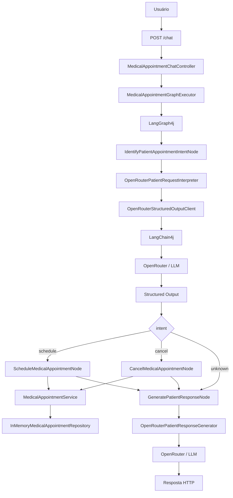
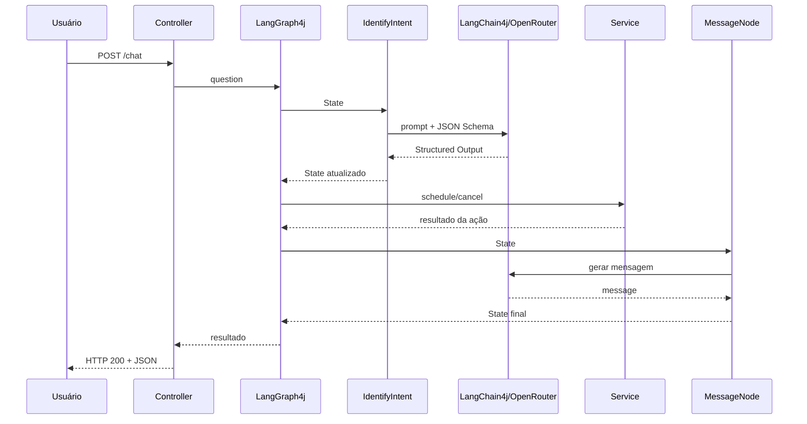

# poc_java_ia_consultamedica

> **Java 21 + Spring Boot + LangChain4j + LangGraph4j + OpenRouter + LangSmith**

Projeto educacional que demonstra como transformar **linguagem natural** em uma ação de negócio controlada: o usuário escreve que deseja agendar ou cancelar uma consulta, a IA extrai a intenção e os dados em formato estruturado, o LangGraph4j decide o fluxo e o Java executa a regra.

> **Importante:** este é um projeto de estudo com dados fictícios. Não use informações médicas reais.

---

## Como usar este README

Este documento tem **dupla função**.

### Se você quer avaliar ou executar o projeto

Leia nesta ordem:

1. [Visão geral](#1-visão-geral)
2. [Arquitetura](#3-arquitetura)
3. [Como executar](#11-como-executar)
4. [API REST](#12-api-rest)
5. [Testes](#14-testes)
6. [Observabilidade](#15-observabilidade)
7. [Limitações](#18-limitações-e-próximos-passos)

### Se você está aprendendo IA aplicada a software

Leia do início ao fim.

As seções explicam:

```text
problema
  ↓
conceitos de IA
  ↓
Structured Output
  ↓
State / Nodes / Edges
  ↓
fluxo real da requisição
  ↓
código Java
  ↓
testes
  ↓
como reproduzir em outro domínio
```

---

## Projeto em uma página

| Item | Informação |
|---|---|
| **Objetivo** | demonstrar IA aplicada a um workflow Java controlado |
| **Domínio** | agendamento/cancelamento de consultas fictícias |
| **Entrada** | linguagem natural |
| **Saída da IA** | JSON estruturado |
| **Workflow** | LangGraph4j |
| **Modelo** | acessado via OpenRouter |
| **Persistência** | memória |
| **Observabilidade** | LangSmith + OpenTelemetry |
| **Endpoint principal** | `POST /chat` |
| **Perfil do projeto** | POC educacional, não produção |

### O que é regra de negócio e o que é IA?

```text
IA:
- entender a frase;
- extrair dados;
- gerar mensagem amigável.

Java:
- validar pré-condições;
- verificar profissional;
- verificar conflito;
- agendar;
- cancelar;
- persistir.
```

> **Decisão de engenharia:** o modelo não recebe autoridade para alterar o estado de negócio diretamente. Ele interpreta a entrada; o Java decide e executa a operação.

---

## Quick start — para ver o projeto funcionando primeiro

Se você quer executar antes de estudar todos os conceitos:

```bash
# 1. configure
cp .env.example .env

# 2. informe OPENROUTER_API_KEY no .env

# 3. testes locais
mvn clean test

# 4. suba a aplicação
mvn spring-boot:run
```

Teste:

```bash
curl --request POST \
  --url http://localhost:3000/chat \
  --header 'Content-Type: application/json' \
  --data '{
    "question": "Meu nome é Maria Santos e quero uma consulta com o Dr. Alicio amanhã às 16h"
  }'
```

> **Para quem está começando:** não tente entender LangSmith, OpenTelemetry e Studio antes de entender `State → Node → Edge → Service`. Observabilidade vem depois do fluxo principal.

---

# 1. Visão geral

## O problema

Aplicações Java trabalham melhor com dados bem definidos.

Exemplo:

```java
long professionalId = 1L;
String patientName = "Maria Santos";
Instant dateTime = ...;
```

Pessoas, porém, falam de forma livre:

```text
Olá, meu nome é Maria Santos.
Quero marcar uma consulta com o Dr. Alicio amanhã às 16h
para fazer um check-up.
```

Antes de executar qualquer regra, o sistema precisa descobrir:

```text
qual é a intenção?
qual profissional foi citado?
qual data e horário?
qual paciente?
qual motivo?
```

A IA é usada para fazer essa **interpretação**.

Depois disso, a regra volta a ser Java tradicional.

---

## O que o projeto faz

O sistema reconhece três intenções:

| Intent | Significado |
|---|---|
| `schedule` | agendar consulta |
| `cancel` | cancelar consulta |
| `unknown` | assunto fora do domínio |

Exemplo de entrada:

```text
Meu nome é Maria Santos e quero uma consulta com o Dr. Alicio amanhã às 16h.
```

Exemplo de informação estruturada:

```json
{
  "intent": "schedule",
  "professionalId": 1,
  "professionalName": "Dr. Alicio da Silva",
  "datetime": "2026-10-05T16:00:00Z",
  "patientName": "Maria Santos",
  "reason": null
}
```

A IA **não grava a consulta**.

Quem faz isso é o código Java.

---

## Princípio arquitetural

A ideia mais importante do projeto é:

> **IA interpreta dados flexíveis; Java controla regras determinísticas.**

```text
Linguagem natural
       ↓
      LLM
       ↓
Structured Output
       ↓
LangGraph4j State
       ↓
Roteamento
       ↓
Service Java
       ↓
Resultado
       ↓
Mensagem para o usuário
```

---

# 2. Tecnologias e responsabilidades

| Tecnologia | Responsabilidade |
|---|---|
| **Java 21** | linguagem principal |
| **Spring Boot** | API REST e configuração da aplicação |
| **Bean Validation** | validação da entrada HTTP |
| **LangChain4j** | integração Java com o modelo de linguagem |
| **OpenRouter** | gateway de acesso ao modelo |
| **Structured Output / JSON Schema** | define o formato esperado da saída da IA |
| **Jackson** | converte JSON em objetos Java |
| **LangGraph4j** | modela o workflow em State, Nodes e Edges |
| **LangGraph4j Studio** | visualiza e executa o grafo localmente |
| **LangSmith** | observabilidade e tracing |
| **OpenTelemetry** | instrumentação e envio dos traces |
| **JUnit** | testes automatizados |
| **Postman** | testes manuais da API |

### Regra de memorização

```text
Spring       → recebe a requisição
LangChain4j  → conversa com a IA
OpenRouter   → fornece acesso ao modelo
LangGraph4j  → controla o fluxo
Service Java → executa a regra
LangSmith    → ajuda a observar a execução
```

---

# 3. Arquitetura

## Visão de componentes



---

## Fluxo do grafo

```text
START
  ↓
identifyIntent
  ↓
  ├── schedule → schedule ─┐
  ├── cancel   → cancel ───┼→ message → END
  └── unknown ─────────────┘
```

Esse desenho é simples de propósito. O objetivo é enxergar claramente:

```text
entrada
  ↓
interpretação
  ↓
decisão
  ↓
ação
  ↓
resposta
```


## Sequência de uma chamada



> **Aprendizado:** o LLM participa do começo e do fim; a alteração de negócio acontece no meio, em código Java comum.

---

# 4. Conceitos de IA que o projeto ensina

## 4.1 LLM

LLM significa **Large Language Model**.

Neste projeto, ela é usada principalmente como um interpretador de linguagem.

Entrada:

```text
Quero cancelar minha consulta com a Dra. Ana amanhã às 14h.
Meu nome é João.
```

Saída desejada:

```json
{
  "intent": "cancel",
  "professionalId": 2,
  "professionalName": "Dra. Ana Pereira",
  "datetime": "2026-10-05T14:00:00Z",
  "patientName": "João"
}
```

A LLM não é:

```text
banco de dados
repository
controller
service
regra de negócio
```

Ela ajuda a transformar uma entrada ambígua em dados que o software entende.

---

## 4.2 Prompt

Prompt é o conjunto de instruções e contexto enviados ao modelo.

Neste projeto, prompts não ficam espalhados aleatoriamente em Strings.

Eles são construídos por classes específicas:

```text
MedicalAppointmentIntentPromptBuilder
PatientResponsePromptBuilder
```

O prompt de intenção informa, por exemplo:

```text
papel do modelo
tarefa
data atual
profissionais disponíveis
intents permitidas
regras de extração
exemplos
```

---

## 4.3 System Message e User Message

### System Message

Define as regras gerais.

Exemplo conceitual:

```text
Você é um classificador de intenções para consultas.
Identifique schedule, cancel ou unknown.
Use apenas os profissionais fornecidos.
```

### User Message

Contém o dado a ser analisado.

```text
Quero marcar com o Dr. Alicio amanhã às 16h.
```

Pense assim:

```text
SystemMessage → "como trabalhar"
UserMessage   → "o que analisar"
```

---

# 5. Structured Output e JSON Schema

## O problema de pedir apenas "responda em JSON"

Imagine este prompt:

```text
Extraia os dados e responda em JSON.
```

O modelo poderia responder:

```text
Claro! Os dados encontrados são:

{
  "intent": "schedule"
}
```

Para uma pessoa, isso é legível.

Para uma aplicação que esperava **somente JSON**, é um problema.

---

## A solução

O projeto utiliza **Structured Output** com JSON Schema.

O schema define formalmente o formato esperado.

Exemplo simplificado:

```json
{
  "type": "object",
  "properties": {
    "intent": {
      "enum": ["schedule", "cancel", "unknown"]
    },
    "patientName": {
      "type": "string"
    }
  },
  "required": ["intent"],
  "additionalProperties": false
}
```

Fluxo técnico:

```text
ChatRequest
   +
SystemMessage
   +
UserMessage
   +
ResponseFormat
   +
JsonSchema
       ↓
   OpenRouter
       ↓
Structured JSON
       ↓
  ObjectMapper
       ↓
  record Java
```

Classes principais:

```text
MedicalAppointmentStructuredOutputSchemas
OpenRouterStructuredOutputClient
ExtractedMedicalAppointmentIntent
```

A documentação do LangChain4j trata JSON Schema como a opção mais confiável entre os mecanismos de saída estruturada quando o modelo/provider oferece suporte. O OpenRouter também permite `response_format` com `json_schema` em endpoints compatíveis.

---

## Structured Output não substitui validação de negócio

Um JSON pode obedecer ao schema:

```json
{
  "intent": "schedule"
}
```

e ainda não ter dados suficientes para agendar.

Por isso existem duas responsabilidades:

```text
JSON Schema
   ↓
garante estrutura

Validação Java
   ↓
garante pré-condições da operação
```

Essa é a razão de existir:

```text
MedicalAppointmentActionStateValidator
```

---

# 6. LangChain4j e OpenRouter

## LangChain4j

LangChain4j fornece abstrações Java para trabalhar com modelos.

O projeto utiliza conceitos como:

```text
ChatModel
ChatRequest
ChatResponse
SystemMessage
UserMessage
ResponseFormat
JsonSchema
ChatModelListener
```

Sem essa abstração, seria possível integrar o provider manualmente com `HttpClient`, mas teríamos que cuidar diretamente de:

```text
HTTP
headers
JSON da requisição
serialização
desserialização
erros do provider
```

---

## OpenRouter

OpenRouter é o gateway escolhido para acessar o modelo.

Configurações principais:

```properties
OPENROUTER_API_KEY=...
OPENROUTER_BASE_URL=https://openrouter.ai/api/v1
OPENROUTER_MODEL=...
```

No código, o modelo é configurado em:

```text
AiClientConfiguration
```

O projeto usa um cliente compatível com a API OpenAI apontando para o endpoint do OpenRouter.

### Por que `require_parameters=true`?

Structured Output depende de recursos que nem todo endpoint/provider oferece.

O OpenRouter recomenda `require_parameters=true` quando é necessário garantir que a requisição seja roteada apenas para endpoints que suportem os parâmetros enviados.

---

# 7. LangGraph4j: State, Nodes e Edges

Esta é a parte mais importante para entender o workflow.

---

## 7.1 State

Classe:

```text
MedicalAppointmentGraphState
```

O State é o contexto compartilhado da execução.

Uma analogia útil:

> O State é uma mochila. Cada Node lê o que precisa e coloca novas informações nela.

Estado inicial:

```json
{
  "messages": [
    "Meu nome é Maria e quero uma consulta amanhã às 16h."
  ]
}
```

Depois da interpretação:

```json
{
  "messages": ["..."],
  "intent": "schedule",
  "professionalId": 1,
  "professionalName": "Dr. Alicio da Silva",
  "datetime": "2026-10-05T16:00:00Z",
  "patientName": "Maria"
}
```

Depois da ação:

```json
{
  "...": "...",
  "actionSuccess": true,
  "appointmentData": {
    "professionalId": 1,
    "patientName": "Maria"
  }
}
```

A documentação do LangGraph4j define `AgentState` como o estado recebido e atualizado pelos Nodes durante a execução.

---

## 7.2 Node

Node é uma etapa do workflow.

Um Node:

```text
recebe o State
     ↓
executa uma responsabilidade
     ↓
devolve atualizações do State
```

Neste projeto:

| Node | Responsabilidade |
|---|---|
| `IdentifyPatientAppointmentIntentNode` | identificar intenção e dados |
| `ScheduleMedicalAppointmentNode` | executar agendamento |
| `CancelMedicalAppointmentNode` | executar cancelamento |
| `GeneratePatientResponseNode` | gerar mensagem final |

---

## 7.3 Edge

Edge é uma transição entre Nodes.

Exemplo:

```text
schedule → message
```

Significa:

> quando `schedule` terminar, execute `message`.

---

## 7.4 Conditional Edge

É uma transição cujo destino depende do State.

Classe:

```text
RoutePatientRequestByIntent
```

Conceitualmente:

```java
switch (intent) {
    case SCHEDULE -> "schedule";
    case CANCEL   -> "cancel";
    case UNKNOWN  -> "message";
}
```

A documentação do LangGraph4j descreve Conditional Edges exatamente para esse tipo de roteamento dinâmico.

---

# 8. O que cada Node faz

## 8.1 IdentifyPatientAppointmentIntentNode

Entrada:

```text
mensagem do paciente
```

Passos:

```text
1. lê a pergunta do State
2. chama PatientRequestInterpreter
3. recebe Structured Output
4. converte a intent
5. atualiza o State
```

Ele **não agenda**.

Sua responsabilidade termina quando a linguagem natural foi convertida em dados estruturados.

---

## 8.2 ScheduleMedicalAppointmentNode

Executado quando:

```text
intent = schedule
```

Passos:

```text
1. valida o State
2. converte datetime para Instant
3. chama MedicalAppointmentService
4. registra sucesso ou erro no State
```

---

## 8.3 CancelMedicalAppointmentNode

Executado quando:

```text
intent = cancel
```

Passos:

```text
1. valida o State
2. procura a consulta
3. pede ao Service para cancelar
4. registra o resultado
```

---

## 8.4 GeneratePatientResponseNode

É a última etapa.

Recebe algo técnico:

```json
{
  "intent": "schedule",
  "actionSuccess": false,
  "actionError": "Horário indisponível"
}
```

e produz uma mensagem adequada ao usuário.

Se essa segunda chamada de IA falhar, o projeto possui um fallback em Java.

Isso demonstra um princípio útil:

> Recursos de IA podem falhar; a aplicação deve definir comportamento de fallback quando isso fizer sentido.

---

# 9. Regra de negócio: onde a IA termina

A regra principal fica em:

```text
MedicalAppointmentService
```

## Agendamento

```text
verificar profissional
      ↓
verificar conflito de horário
      ↓
criar MedicalAppointment
      ↓
salvar
```

## Cancelamento

```text
verificar profissional
      ↓
localizar consulta
      ↓
remover
```

Essa separação é intencional.

Evite pensar:

```text
"Vou colocar a regra inteira no prompt."
```

Prefira:

```text
LLM     → interpretação
Service → regra de negócio
```

---

# 10. Raio-X de uma requisição

Vamos seguir uma execução inteira.

Entrada HTTP:

```json
{
  "question": "Meu nome é Maria Santos e quero uma consulta com o Dr. Alicio amanhã às 16h"
}
```

---

## Passo 1 — Controller

```text
MedicalAppointmentChatController
```

Responsabilidades:

```text
receber HTTP
validar entrada
chamar o executor
devolver HTTP
```

Ele não contém regra de IA nem regra de negócio.

---

## Passo 2 — Executor

```text
MedicalAppointmentGraphExecutor
```

Cria a entrada inicial:

```json
{
  "messages": [
    "Meu nome é Maria Santos e quero uma consulta..."
  ]
}
```

e inicia o grafo.

---

## Passo 3 — Identificação

```text
IdentifyPatientAppointmentIntentNode
```

chama:

```text
OpenRouterPatientRequestInterpreter
```

---

## Passo 4 — Prompt

```text
MedicalAppointmentIntentPromptBuilder
```

adiciona:

```text
regras
profissionais
data atual
exemplos
instruções de extração
```

A data atual é importante para expressões como:

```text
hoje
amanhã
depois de amanhã
```

---

## Passo 5 — Schema

```text
MedicalAppointmentStructuredOutputSchemas
```

define a estrutura esperada.

---

## Passo 6 — Chamada ao modelo

```text
OpenRouterStructuredOutputClient
```

monta a requisição e chama:

```java
chatModel.chat(...)
```

---

## Passo 7 — Desserialização

A resposta JSON é convertida para:

```text
ExtractedMedicalAppointmentIntent
```

Agora temos um objeto Java tipado.

---

## Passo 8 — Atualização do State

O Node adiciona:

```text
intent
professionalId
professionalName
datetime
patientName
reason
```

---

## Passo 9 — Roteamento

```text
RoutePatientRequestByIntent
```

lê:

```text
intent = schedule
```

e escolhe:

```text
ScheduleMedicalAppointmentNode
```

---

## Passo 10 — Validação

```text
MedicalAppointmentActionStateValidator
```

confere se a ação tem dados suficientes.

Essa é a ideia:

> **confia no resultado estruturado, mas valida de novo na fronteira da regra.**

---

## Passo 11 — Service

```text
MedicalAppointmentService
```

executa a regra Java.

---

## Passo 12 — Mensagem final

O grafo segue para:

```text
GeneratePatientResponseNode
```

que chama a IA novamente para transformar o resultado técnico em uma frase amigável.

---

## Passo 13 — Resposta HTTP

O Controller devolve o resultado.

Fim.

---

# 11. Como executar

## Pré-requisitos

```text
JDK 21
Maven 3.9+
```

Verifique:

```bash
java -version
mvn -version
```

---

## Configure as variáveis

Copie:

```text
.env.example
```

para:

```text
.env
```

Linux/macOS:

```bash
cp .env.example .env
```

PowerShell:

```powershell
Copy-Item .env.example .env
```

### Configuração mínima

```properties
OPENROUTER_API_KEY=sua_chave
OPENROUTER_MODEL=arcee-ai/trinity-large-preview:free

LANGSMITH_TRACING=false
```

> O modelo acima é o padrão configurado nesta POC. Disponibilidade e suporte a Structured Output podem mudar. Se necessário, configure outro modelo/provider compatível.


## Referência de configuração

| Variável | Obrigatória? | Função |
|---|---:|---|
| `OPENROUTER_API_KEY` | sim | autenticação no OpenRouter |
| `OPENROUTER_BASE_URL` | não | endpoint compatível com OpenAI |
| `OPENROUTER_MODEL` | sim* | modelo utilizado |
| `OPENROUTER_TEMPERATURE` | não | controla variabilidade da geração |
| `OPENROUTER_TIMEOUT_SECONDS` | não | timeout da chamada |
| `OPENROUTER_HTTP_REFERER` | não | metadado opcional do OpenRouter |
| `OPENROUTER_X_TITLE` | não | nome opcional da aplicação |
| `LANGSMITH_TRACING` | não | liga/desliga tracing |
| `LANGSMITH_API_KEY` | se tracing=true | autenticação no LangSmith |
| `LANGSMITH_PROJECT` | se tracing=true | agrupa traces |
| `LANGSMITH_ENDPOINT` | não | endpoint do LangSmith |
| `LANGSMITH_INCLUDE_LLM_PAYLOADS` | não | controla inclusão de payloads do LLM no trace |

`*` O projeto possui um valor padrão, mas mantê-lo no `.env` torna a configuração explícita.

> **Documentação técnica:** segredos ficam fora do código e o `.env` não deve ser versionado.

---

## Rode os testes

```bash
mvn clean test
```

---

## Inicie a aplicação

```bash
mvn spring-boot:run
```

Servidor:

```text
http://localhost:3000
```

---

# 12. API REST

## POST `/chat`

Endpoint principal, preservado do projeto original.

### Request

```json
{
  "question": "Meu nome é Maria Santos e quero uma consulta com o Dr. Alicio amanhã às 16h"
}
```

Regra de entrada:

```text
question:
obrigatória
mínimo de 10 caracteres
```

### Exemplo com cURL

```bash
curl --request POST \
  --url http://localhost:3000/chat \
  --header 'Content-Type: application/json' \
  --data '{
    "question": "Meu nome é Maria Santos e quero uma consulta com o Dr. Alicio amanhã às 16h"
  }'
```

---

## Alias

Também existe:

```text
POST /api/medical-appointments/chat
```

O alias é mais descritivo para uma API REST, mas `/chat` foi mantido por compatibilidade com o exemplo original.

---

## Campos relevantes da resposta

```text
messages
intent
professionalId
professionalName
datetime
patientName
reason
actionSuccess
actionError
error
appointmentData
message
```


### Exemplo de resposta de sucesso

```json
{
  "messages": [
    "Meu nome é Maria Santos e quero uma consulta com o Dr. Alicio amanhã às 16h",
    "Sua consulta foi agendada com sucesso."
  ],
  "intent": "schedule",
  "professionalId": 1,
  "professionalName": "Dr. Alicio da Silva",
  "datetime": "2026-10-05T16:00:00Z",
  "patientName": "Maria Santos",
  "reason": null,
  "actionSuccess": true,
  "actionError": null,
  "error": null,
  "appointmentData": {
    "professionalId": 1,
    "patientName": "Maria Santos"
  },
  "message": "Sua consulta foi agendada com sucesso."
}
```

> **Observação:** o texto da mensagem pode variar porque é gerado por modelo. Campos de negócio e routing são os pontos mais importantes para testes determinísticos.

---

# 13. Dados de demonstração

O projeto possui profissionais fictícios cadastrados em memória.

A fonte está em:

```text
MedicalProfessionalDirectory
```

Os agendamentos também são mantidos em memória:

```text
InMemoryMedicalAppointmentRepository
```

Consequência:

> Ao reiniciar a aplicação, alterações feitas durante a execução são perdidas.

Isso foi mantido para que a POC foque em IA e workflow, e não em persistência.

---

# 14. Testes

## Comportamentos que o projeto deve garantir

| Cenário | Resultado esperado |
|---|---|
| pedido de agendamento válido | `intent=schedule` e ação executada |
| horário ocupado | `actionSuccess=false` com `actionError` |
| cancelamento existente | `intent=cancel` e remoção da consulta |
| cancelamento inexistente | erro de negócio, não erro de parsing |
| assunto fora do domínio | `intent=unknown` e nenhuma alteração de negócio |
| falha na geração da mensagem final | fallback Java |
| teste unitário/local | não depende obrigatoriamente de LLM externo |

> **Aprendizado:** em sistemas com IA, teste o que deve ser determinístico separadamente do que é probabilístico.


## 14.1 Testes de regra

```text
MedicalAppointmentServiceTest
```

Testam Java puro e regras previsíveis.

---

## 14.2 Teste do workflow

```text
MedicalAppointmentGraphFlowTest
```

Usa dependências controladas para verificar o caminho do grafo sem depender de uma LLM real.

Isso é importante porque testes de negócio não deveriam depender sempre de:

```text
internet
API externa
quota
rate limit
resposta probabilística
```

---

## 14.3 E2E real com OpenRouter

```text
OpenRouterMedicalAppointmentE2ETest
```

Executa o caminho real.

```bash
mvn -DrunOpenRouterE2E=true \
    -Dtest=OpenRouterMedicalAppointmentE2ETest \
    test
```

Pré-requisitos:

```text
OPENROUTER_API_KEY válida
internet
modelo disponível
endpoint compatível
```

---

# 15. Observabilidade

## 15.1 LangGraph4j Studio

Com a aplicação rodando:

```text
http://localhost:3000/?instance=medical_appointments
```

Use o Studio para visualizar:

```text
START
  ↓
identifyIntent
  ↓
schedule / cancel / message
  ↓
message
  ↓
END
```

Ele é útil para aprender e depurar o workflow.

---

## 15.2 LangSmith

LangSmith não executa o modelo.

Ele recebe informações de observabilidade.

Configuração:

```properties
LANGSMITH_API_KEY=sua_chave
LANGSMITH_TRACING=true
LANGSMITH_PROJECT=poc-java-ia-consultamedica
LANGSMITH_ENDPOINT=https://api.smith.langchain.com
```

Fluxo conceitual:

```text
LangGraph4j / LangChain4j
        ↓
OpenTelemetry
        ↓
LangSmith
```

Trace esperado:

```text
medical_appointments
├── identifyIntent
│   └── openrouter.chat
├── schedule ou cancel
└── message
    └── openrouter.chat
```

Para estudar o básico primeiro:

```properties
LANGSMITH_TRACING=false
```

Habilite tracing depois que o workflow principal estiver claro.

---

# 16. Estrutura do código

```text
src/main/java/.../
│
├── api/
│   ├── MedicalAppointmentChatController
│   ├── MedicalAppointmentChatRequest
│   └── MedicalAppointmentChatResponse
│
├── ai/
│   ├── OpenRouterStructuredOutputClient
│   ├── OpenRouterPatientRequestInterpreter
│   ├── OpenRouterPatientResponseGenerator
│   ├── prompt/
│   └── schema/
│
├── graph/
│   ├── MedicalAppointmentGraphConfiguration
│   ├── MedicalAppointmentGraphExecutor
│   ├── MedicalAppointmentGraphState
│   ├── node/
│   ├── route/
│   └── validation/
│
├── service/
│   ├── MedicalAppointmentService
│   └── MedicalProfessionalDirectory
│
├── repository/
│   └── InMemoryMedicalAppointmentRepository
│
├── config/
│   ├── AiClientConfiguration
│   └── LangGraphStudioConfiguration
│
└── observability/
    ├── LangGraphTracingConfiguration
    └── LangSmithChatModelTraceListener
```

---

# 17. Guia de estudo passo a passo

Não leia todas as classes aleatoriamente.

## Etapa 1 — HTTP

Estude:

```text
MedicalAppointmentChatController
MedicalAppointmentChatRequest
MedicalAppointmentChatResponse
```

Pergunta a responder:

> Como os dados entram e saem?

---

## Etapa 2 — Grafo

```text
MedicalAppointmentGraphExecutor
MedicalAppointmentGraphConfiguration
MedicalAppointmentGraphState
```

Pergunta:

> Onde o workflow começa e onde o contexto é armazenado?

---

## Etapa 3 — IA de entrada

```text
IdentifyPatientAppointmentIntentNode
OpenRouterPatientRequestInterpreter
MedicalAppointmentIntentPromptBuilder
MedicalAppointmentStructuredOutputSchemas
OpenRouterStructuredOutputClient
```

Pergunta:

> Como uma String vira um objeto Java estruturado?

---

## Etapa 4 — Roteamento

```text
RoutePatientRequestByIntent
```

Pergunta:

> Como `intent` altera o caminho da aplicação?

---

## Etapa 5 — Regra Java

```text
MedicalAppointmentActionStateValidator
ScheduleMedicalAppointmentNode
CancelMedicalAppointmentNode
MedicalAppointmentService
InMemoryMedicalAppointmentRepository
```

Pergunta:

> Onde termina a interpretação da IA e começa a regra determinística?

---

## Etapa 6 — Resposta

```text
GeneratePatientResponseNode
OpenRouterPatientResponseGenerator
PatientResponsePromptBuilder
```

Pergunta:

> Como um resultado técnico vira uma mensagem amigável?

---

## Etapa 7 — Observabilidade

```text
LangGraphStudioConfiguration
LangSmithOpenTelemetryConfiguration
LangGraphTracingConfiguration
LangSmithChatModelTraceListener
```

Pergunta:

> Como observar o que aconteceu sem misturar observabilidade com regra de negócio?

---

# 18. Limitações e próximos passos

Esta POC não implementa:

```text
autenticação
autorização
PostgreSQL
LGPD para produção
controle completo de timezone
idempotência
concorrência distribuída
circuit breaker
retry de produção
confirmação humana
memória persistente de conversa
```

Isso é proposital.

O objetivo atual é dominar:

```text
LLM
+
Structured Output
+
State
+
Workflow
+
Regra Java
```

Possíveis evoluções:

1. criar `check_availability`;
2. adicionar confirmação antes do cancelamento;
3. substituir memória por PostgreSQL;
4. criar IDs de consulta;
5. adicionar timezone explícito;
6. implementar fallback de modelo;
7. adicionar métricas;
8. criar avaliações automatizadas do Structured Output.

---

## O que faltaria para produção?

Esta POC é intencionalmente menor que um sistema real.

Para produção, seria necessário avaliar pelo menos:

```text
persistência transacional
autenticação e autorização
LGPD e redaction
timezone do paciente/clínica
idempotência
locking/concorrência de horários
retry e circuit breaker
rate limiting
métricas e alertas
auditoria
confirmação de ações destrutivas
avaliação de qualidade do LLM
fallback de provider/modelo
```

> **Decisão de escopo:** esses itens não foram adicionados porque prejudicariam o objetivo didático da POC. Eles são evolução, não pré-requisito para aprender o padrão.

---

# 19. Troubleshooting

## `OPENROUTER_API_KEY` não configurada

Verifique:

```properties
OPENROUTER_API_KEY=...
```

no `.env`.

---

## Modelo não aceita Structured Output

Sintoma:

```text
erro relacionado a response_format/json_schema
```

Verifique se o modelo/provider configurado suporta Structured Outputs.

O OpenRouter documenta esse suporte por endpoint/provider e recomenda `require_parameters=true` quando esses parâmetros são obrigatórios.

---

## `intent` parece correta, mas a ação falha

Isso pode ser esperado.

Exemplo:

```text
intent = schedule
```

mas faltou:

```text
patientName
datetime
professionalId
```

Structured Output e validação da ação são camadas diferentes.

---

## Consulta criada desapareceu

O repository é em memória.

Reiniciar a aplicação limpa os dados criados durante a execução.

---

## Trace não aparece

Confira:

```properties
LANGSMITH_TRACING=true
LANGSMITH_API_KEY=...
LANGSMITH_PROJECT=...
```

Se estiver apenas estudando o fluxo funcional, mantenha tracing desligado inicialmente.

---

# 20. Como reproduzir o conhecimento em outro projeto

Esta é a seção mais importante para verificar se você realmente aprendeu.

Não copie este projeto inteiro.

Repita o raciocínio.

---

## Passo 1 — escolha um domínio pequeno

Exemplo:

```text
suporte técnico
```

Entrada:

```text
Meu sistema não abre. Quero criar um chamado.
```

---

## Passo 2 — defina as intenções

```text
open_ticket
close_ticket
unknown
```

---

## Passo 3 — desenhe o Structured Output

```json
{
  "intent": "open_ticket",
  "customerName": "Maria",
  "category": "system_error",
  "description": "Sistema não abre"
}
```

Antes de escrever código, pergunte:

```text
quais campos preciso extrair?
quais são obrigatórios?
quais são opcionais?
```

---

## Passo 4 — crie o tipo Java

```java
record ExtractedSupportIntent(
        String intent,
        String customerName,
        String category,
        String description
) {
}
```

---

## Passo 5 — crie o JSON Schema

Defina:

```text
tipos
enum
required
descrições
additionalProperties
```

---

## Passo 6 — prove a extração antes do grafo

Primeiro faça funcionar:

```text
String
  ↓
LLM
  ↓
Structured JSON
  ↓
record Java
```

Só depois adicione LangGraph4j.

---

## Passo 7 — modele o State

Exemplo:

```text
messages
intent
customerName
category
description
actionSuccess
actionError
```

---

## Passo 8 — crie os Nodes

```text
identifyIntent
openTicket
closeTicket
generateMessage
```

---

## Passo 9 — desenhe o grafo

```text
START
  ↓
identifyIntent
  ├─ open_ticket  → openTicket  ┐
  ├─ close_ticket → closeTicket ├→ message → END
  └─ unknown ───────────────────┘
```

---

## Passo 10 — Service Java

Crie:

```java
SupportTicketService.openTicket(...)
SupportTicketService.closeTicket(...)
```

A LLM entende a frase.

O Service executa a regra.

---

## Passo 11 — teste sem LLM real

Substitua o interpretador por uma implementação controlada e confirme o routing.

---

## Passo 12 — E2E real

Depois teste:

```text
HTTP
→ modelo
→ Structured Output
→ State
→ Graph
→ Service
→ resposta
```

---

## Passo 13 — observabilidade

Somente depois adicione:

```text
Studio
tracing
LangSmith
métricas
```

Se você consegue executar esses passos em outro domínio, o conhecimento foi transferido.

---

# 21. Exercícios

## Nível 1 — compreensão

Responda sem abrir o código:

1. Quem recebe o HTTP?
2. Qual classe contém o State?
3. Quem chama o modelo?
4. Onde está o JSON Schema?
5. Quem decide schedule/cancel?
6. Qual classe realmente agenda?
7. Qual a diferença entre `actionError` e erro de processamento?
8. Para que serve LangSmith?

---

## Nível 2 — alteração simples

Adicione um novo profissional em:

```text
MedicalProfessionalDirectory
```

Depois teste uma frase mencionando esse profissional.

---

## Nível 3 — nova intenção

Implemente:

```text
check_availability
```

Você provavelmente precisará alterar:

```text
enum
schema
prompt
router
novo Node
Service
testes
```

---

## Nível 4 — novo projeto

Crie:

```text
poc_java_ia_suporte
```

sem copiar classes completas.

Use somente o padrão aprendido.

---

# 22. Mapeamento das aulas para o código Java

| Aula | Conceitos | Onde estão no Java |
|---|---|---|
| Módulo 03-01 | intent, State, Nodes, Edges | `graph/` |
| Módulo 03-02 | JSON Prompt, Structured Output, OpenRouter | `ai/`, `prompt/`, `schema/` |
| Módulo 03-03 | texto → JSON → State → routing | `IdentifyPatientAppointmentIntentNode` |
| Módulo 03-04 | actions, validação, E2E, Studio, trace | `node/`, `service/`, `observability/` |

Documentação detalhada da migração:

```text
docs/ANALISE_MIGRACAO.md
```

Validação técnica da entrega:

```text
docs/VALIDACAO_FINAL.md
```

---

# 23. Decisões de projeto

## Por que repository em memória?

Para reduzir conceitos simultâneos.

O foco é IA + workflow.

---

## Por que interfaces para IA?

Para permitir testes sem dependência externa.

```text
PatientRequestInterpreter
PatientResponseGenerator
```

---

## Por que LangGraph4j se um `if/else` resolveria?

Porque o objetivo é estudar um padrão que consiga evoluir para fluxos maiores.

---

## Por que não deixar a IA executar o Service?

Porque ações de negócio precisam ser previsíveis, testáveis e auditáveis.

---

## Por que duas chamadas ao modelo?

Uma é especializada em **entender**.

A outra é especializada em **comunicar o resultado**.

Separar responsabilidades torna o fluxo mais fácil de testar e evoluir.

---

# 24. Segurança e privacidade

Nunca versione:

```text
.env
```

Nunca publique:

```text
OPENROUTER_API_KEY
LANGSMITH_API_KEY
```

Com tracing habilitado, dados do State, prompts ou respostas podem ser registrados dependendo da configuração.

Por isso:

> **não utilize dados médicos reais nesta POC.**

---

# 25. Checklist de aprendizado

Antes de considerar o estudo concluído, tente explicar sem consultar:

```text
[ ] LLM
[ ] Prompt
[ ] SystemMessage
[ ] UserMessage
[ ] Structured Output
[ ] JSON Schema
[ ] LangChain4j
[ ] OpenRouter
[ ] State
[ ] Node
[ ] Edge
[ ] Conditional Edge
[ ] LangGraph4j
[ ] Service
[ ] segunda validação
[ ] fallback
[ ] Studio
[ ] LangSmith
[ ] OpenTelemetry
[ ] como criar outra POC
```

---

# 26. Resumo em 30 segundos

```text
1. Spring recebe uma frase.
2. LangChain4j envia essa frase ao modelo via OpenRouter.
3. O modelo devolve Structured Output.
4. Os dados entram no State.
5. LangGraph4j escolhe o próximo Node.
6. Java executa a regra de negócio.
7. O resultado volta para o State.
8. A IA gera uma mensagem amigável.
9. Spring devolve a resposta.
10. LangSmith pode registrar o trace.
```

A principal lição:

> **Use IA onde existe ambiguidade de linguagem. Use Java onde precisa existir controle determinístico.**

---

# Referências oficiais

- LangChain4j — https://docs.langchain4j.dev/
- Structured Outputs — https://docs.langchain4j.dev/tutorials/structured-outputs/
- LangGraph4j — https://langgraph4j.github.io/langgraph4j/
- OpenRouter — https://openrouter.ai/docs
- OpenRouter Structured Outputs — https://openrouter.ai/docs/guides/features/structured-outputs
- LangSmith — https://docs.langchain.com/langsmith/
- OpenTelemetry Java — https://opentelemetry.io/docs/languages/java/
- Spring Boot — https://spring.io/projects/spring-boot
