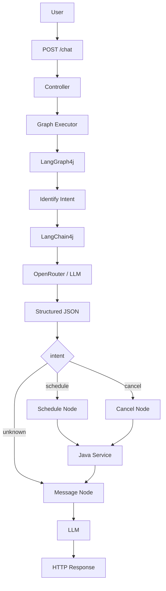

# poc_java_ia_consultamedica

A learning-oriented **Java 21 + Spring Boot** POC designed to teach, step by step, how a Java application can use AI to **understand natural language**, transform it into **structured data**, and execute predictable business logic.

The chosen domain is intentionally simple: **scheduling and cancelling fictional medical appointments**.

> **Study project. Do not use real medical data.**

---

# 1. What should you know after studying this README?

The goal is not only to run the application.

After studying it, you should be able to explain:

1. what an LLM is;
2. what a prompt is;
3. System Message vs User Message;
4. why Structured Output is useful;
5. what JSON Schema is;
6. what LangChain4j does;
7. what OpenRouter does;
8. what State means;
9. what a Node is;
10. what an Edge is;
11. what a Conditional Edge is;
12. how LangGraph4j controls the workflow;
13. why AI does not directly own the business rule;
14. what Studio, LangSmith and OpenTelemetry do;
15. how to build another project with the same pattern.

If you can explain these concepts without looking at this file, the learning goal has been achieved.

---

# 2. The problem

Java works best with known values:

```java
long professionalId = 1L;
String patientName = "Maria Santos";
Instant dateTime = ...;
```

People do not naturally speak that way.

A user writes:

```text
Hello, my name is Maria Santos.
I want an appointment with Dr. Alicio tomorrow at 4 PM
for a regular check-up.
```

Java does not naturally know that:

```text
"want an appointment" = schedule intent
"Dr. Alicio"          = professional ID 1
"tomorrow at 4 PM"    = a date/time
"Maria Santos"        = patient
"check-up"            = reason
```

AI is used to bridge:

```text
HUMAN LANGUAGE
      ↓
     AI
      ↓
STRUCTURED DATA
```

After that, normal Java code can take over.

---

# 3. Main idea

This project does **not use AI for everything**.

Responsibilities are separated:

```text
Human sentence
      ↓
AI interprets
      ↓
Structured Output
      ↓
Data enters State
      ↓
LangGraph4j routes
      ↓
Java executes business rule
      ↓
Result returns to State
      ↓
AI writes friendly message
      ↓
HTTP response
```

The most important idea:

> **AI interprets flexible input; Java controls deterministic business behavior.**

---

# 4. Eight concepts first

## 4.1 LLM

A Large Language Model processes language.

Here it mainly turns human sentences into structured meaning.

It is not the database, controller, service or repository.

---

## 4.2 Prompt

A prompt tells the model:

```text
role
task
rules
context
examples
expected behavior
```

Prompt builders:

```text
MedicalAppointmentIntentPromptBuilder
PatientResponsePromptBuilder
```

---

## 4.3 System Message

Contains stable instructions and context.

Think:

```text
"This is the job and these are the rules."
```

---

## 4.4 User Message

Contains the actual input to process.

Think:

```text
"This is what the patient said."
```

---

## 4.5 Structured Output

Instead of accepting arbitrary prose, the application requests a defined structure.

Example:

```json
{
  "intent": "schedule",
  "patientName": "Maria"
}
```

---

## 4.6 JSON Schema

Describes the expected JSON structure.

Example:

```json
{
  "type": "object",
  "properties": {
    "intent": {
      "enum": ["schedule", "cancel", "unknown"]
    }
  },
  "required": ["intent"]
}
```

The project's schemas live in:

```text
MedicalAppointmentStructuredOutputSchemas
```

---

## 4.7 Workflow

The workflow is the application path:

```text
identify
   ↓
schedule / cancel / unknown
   ↓
message
```

LangGraph4j makes this explicit.

---

## 4.8 Observability

Observability answers:

```text
Which Node ran?
Which route was selected?
How long did the LLM call take?
What failed?
```

Here:

```text
Studio        → local graph visualization
LangSmith     → trace analysis
OpenTelemetry → trace transport/instrumentation
```

---

# 5. Technology map

| Technology | Responsibility |
|---|---|
| Java 21 | main language |
| Spring Boot | REST application |
| Bean Validation | request validation |
| LangChain4j | Java ↔ LLM integration |
| OpenRouter | model gateway |
| Jackson | JSON ↔ Java objects |
| LangGraph4j | workflow |
| Studio | graph inspection |
| LangSmith | observability |
| OpenTelemetry | traces |
| JUnit | tests |
| Postman | manual API tests |

Remember:

```text
Spring       → receives
LangChain4j  → talks to AI
OpenRouter   → gives model access
LangGraph4j  → routes
Java Service → acts
LangSmith    → observes
```

---

# 6. Architecture



Normal schedule/cancel flow uses two LLM calls:

```text
1. understand the request
2. create the final friendly message
```

The business operation itself remains Java.

---

# 7. State

`MedicalAppointmentGraphState` represents shared workflow State.

Think of it as a **backpack**.

At the beginning:

```json
{
  "messages": ["I want an appointment tomorrow at 4 PM."]
}
```

After interpretation:

```json
{
  "messages": ["..."],
  "intent": "schedule",
  "professionalId": 1,
  "datetime": "2026-10-04T16:00:00Z",
  "patientName": "Maria"
}
```

After the action:

```json
{
  "...": "...",
  "actionSuccess": true
}
```

The same State moves through the workflow.

---

# 8. Nodes

## IdentifyPatientAppointmentIntentNode

Converts:

```text
unstructured human language
```

into structured fields.

---

## ScheduleMedicalAppointmentNode

Runs when:

```text
intent = schedule
```

It validates data and calls the Java service.

---

## CancelMedicalAppointmentNode

Runs when:

```text
intent = cancel
```

It validates and asks the service to remove the matching appointment.

---

## GeneratePatientResponseNode

Turns technical State into a friendly message.

It also has a deterministic Java fallback if the second AI call fails.

---

# 9. Edges

Normal edge:

```text
schedule → message
```

Conditional edge:

```text
schedule → schedule
cancel   → cancel
unknown  → message
```

Routing class:

```text
RoutePatientRequestByIntent
```

---

# 10. Graph definition

Class:

```text
MedicalAppointmentGraphConfiguration
```

Conceptually:

```java
addNode(...)
addEdge(START, ...)
addConditionalEdges(...)
addEdge(..., END)
```

The `StateGraph` is compiled into a runnable `CompiledGraph`.

---

# 11. One request, step by step

Input:

```json
{
  "question": "My name is Maria Santos and I want an appointment with Dr. Alicio tomorrow at 4 PM"
}
```

## Step 1

Controller receives HTTP.

## Step 2

Graph Executor creates:

```json
{
  "messages": ["..."]
}
```

## Step 3

Identify Intent Node reads the patient question.

## Step 4

Prompt Builder creates the instructions and context.

## Step 5

The project selects the intent JSON Schema.

## Step 6

`OpenRouterStructuredOutputClient` creates:

```text
SystemMessage
+
UserMessage
+
ResponseFormat
+
JsonSchema
```

## Step 7

LangChain4j calls OpenRouter.

## Step 8

JSON is deserialized into:

```text
ExtractedMedicalAppointmentIntent
```

## Step 9

The Node updates State.

## Step 10

Conditional Edge routes to schedule.

## Step 11

Java validates required fields.

## Step 12

`MedicalAppointmentService` performs the business operation.

## Step 13

Action result is added to State.

## Step 14

Message Node produces a friendly response.

## Step 15

Spring returns HTTP.

That is the complete project in one sequence.

---

# 12. Structured Output in more depth

Without it, a model might produce prose plus JSON.

With JSON Schema, the expected shape is explicitly defined.

LangChain4j supports `ResponseFormat + JsonSchema` in the low-level `ChatModel` API.

OpenRouter supports Structured Outputs for compatible endpoints using:

```text
response_format
type = json_schema
```

Important:

> **Schema-valid does not mean business-valid.**

A valid JSON can still be missing information needed to perform an operation.

Therefore:

```text
Schema validation
       ↓
Business validation
```

are separate concerns.

---

# 13. Why LangChain4j?

It provides model-oriented abstractions such as:

```text
ChatModel
ChatRequest
ChatResponse
SystemMessage
UserMessage
ResponseFormat
JsonSchema
ChatModelListener
```

This avoids writing all provider HTTP integration manually.

---

# 14. Why OpenRouter?

It is the gateway configured by this project.

```properties
OPENROUTER_API_KEY=...
OPENROUTER_BASE_URL=https://openrouter.ai/api/v1
OPENROUTER_MODEL=...
```

The model name is configuration, not business logic.

Structured Output support can vary by model/provider endpoint, so model compatibility must be checked if the configured model changes.

---

# 15. Why LangGraph4j?

A simple `if/else` could implement this small example.

LangGraph4j is used because the project is teaching a workflow pattern that can grow:

```text
identify
 ↓
missing data?
 ↓
ask user
 ↓
availability
 ↓
confirmation
 ↓
schedule
 ↓
message
```

Explicit State, Nodes and Edges make larger flows easier to inspect.

---

# 16. Workflow before "agents"

For learning, understand this project as a controlled **AI workflow** first.

Do not start with the idea of a fully autonomous agent.

Master:

```text
State
Node
Edge
Conditional Edge
LLM call
Java action
```

before moving to more autonomous agentic systems.

---

# 17. Prompt design

The intent prompt includes:

```text
role
task
professionals
current date
rules
extraction instructions
examples
```

Why current date?

Because:

```text
"tomorrow"
```

requires a date reference.

Why professionals?

To map:

```text
"Dr. Alicio" → professionalId
```

---

# 18. Business rules

Class:

```text
MedicalAppointmentService
```

Schedule:

```text
check professional
check time conflict
create appointment
save
```

Cancel:

```text
check professional
find exact appointment
delete
```

Key lesson:

> **A prompt is not a replacement for a business service.**

---

# 19. In-memory repository

Class:

```text
InMemoryMedicalAppointmentRepository
```

This POC intentionally avoids a real database so that the learning focus remains:

```text
LLM
Structured Output
LangGraph4j
business boundary
tracing
```

Restarting the application resets runtime changes.

---

# 20. AI interfaces and testing

Contracts:

```text
PatientRequestInterpreter
PatientResponseGenerator
```

Real implementations:

```text
OpenRouterPatientRequestInterpreter
OpenRouterPatientResponseGenerator
```

This allows tests to replace external AI with controlled implementations.

Engineering lesson:

> **Put external dependencies behind contracts.**

---

# 21. Processing error vs business error

## processingError

Examples:

```text
provider unavailable
empty LLM response
JSON conversion failure
```

## actionError

Examples:

```text
time unavailable
appointment not found
professional not found
```

This distinction makes debugging easier.

---

# 22. Studio

Open:

```text
http://localhost:3000/?instance=medical_appointments
```

Input:

```text
messages
```

Use Studio to understand graph structure and execution.

---

# 23. LangSmith and OpenTelemetry

OpenRouter executes model calls.

LangSmith observes traces.

Conceptually:

```text
LangGraph4j / LangChain4j
        ↓
OpenTelemetry
        ↓
LangSmith
```

Example trace:

```text
medical_appointments
├── identifyIntent
│   └── openrouter.chat
├── schedule
└── message
    └── openrouter.chat
```

Start learning with tracing disabled:

```properties
LANGSMITH_TRACING=false
```

Enable it after the main flow is clear.

---

# 24. Environment variables

Minimal:

```properties
OPENROUTER_API_KEY=your_key
OPENROUTER_MODEL=arcee-ai/trinity-large-preview:free
LANGSMITH_TRACING=false
```

With LangSmith:

```properties
LANGSMITH_API_KEY=your_key
LANGSMITH_TRACING=true
LANGSMITH_PROJECT=poc-java-ia-consultamedica
LANGSMITH_ENDPOINT=https://api.smith.langchain.com
```

Model availability and endpoint features can change. If necessary, configure another Structured Output-compatible model/provider.

---

# 25. Run

Requirements:

```text
JDK 21
Maven 3.9+
```

Tests:

```bash
mvn clean test
```

Start:

```bash
mvn spring-boot:run
```

Server:

```text
http://localhost:3000
```

---

# 26. API

Main endpoint:

```text
POST /chat
```

Alias:

```text
POST /api/medical-appointments/chat
```

Example:

```bash
curl --request POST \
  --url http://localhost:3000/chat \
  --header 'Content-Type: application/json' \
  --data '{
    "question": "My name is Maria Santos and I want an appointment with Dr. Alicio da Silva tomorrow at 4 PM"
  }'
```

---

# 27. Three useful learning scenarios

## Schedule

Observe:

```text
intent = schedule
```

## Cancel

Observe:

```text
intent = cancel
```

## Unknown

Ask something outside the domain and observe:

```text
intent = unknown
```

This is the easiest way to understand the Conditional Edge.

---

# 28. Postman

Collection:

```text
postman/poc_java_ia_consultamedica.postman_collection.json
```

Suggested learning sequence:

```text
request
→ logs
→ State
→ Studio
→ trace
```

---

# 29. Automated tests

`MedicalAppointmentServiceTest`

```text
tests Java business logic
```

`MedicalAppointmentGraphFlowTest`

```text
tests graph routing without a real external LLM
```

`OpenRouterMedicalAppointmentE2ETest`

```text
tests the real integration
```

Run real E2E explicitly:

```bash
mvn -DrunOpenRouterE2E=true \
    -Dtest=OpenRouterMedicalAppointmentE2ETest \
    test
```

---

# 30. Recommended reading order

## Stage 1 — HTTP

```text
MedicalAppointmentChatController
MedicalAppointmentChatRequest
MedicalAppointmentChatResponse
```

## Stage 2 — Graph

```text
MedicalAppointmentGraphExecutor
MedicalAppointmentGraphConfiguration
MedicalAppointmentGraphState
```

## Stage 3 — AI input

```text
IdentifyPatientAppointmentIntentNode
OpenRouterPatientRequestInterpreter
MedicalAppointmentIntentPromptBuilder
MedicalAppointmentStructuredOutputSchemas
OpenRouterStructuredOutputClient
```

## Stage 4 — Routing

```text
RoutePatientRequestByIntent
```

## Stage 5 — Business

```text
MedicalAppointmentActionStateValidator
ScheduleMedicalAppointmentNode
CancelMedicalAppointmentNode
MedicalAppointmentService
InMemoryMedicalAppointmentRepository
```

## Stage 6 — AI output

```text
GeneratePatientResponseNode
OpenRouterPatientResponseGenerator
PatientResponsePromptBuilder
```

## Stage 7 — Observability

```text
LangGraphStudioConfiguration
LangSmithOpenTelemetryConfiguration
LangGraphTracingConfiguration
LangSmithChatModelTraceListener
```

---

# 31. Concept-to-class map

| Concept | Main class |
|---|---|
| REST | `MedicalAppointmentChatController` |
| workflow | `MedicalAppointmentGraphConfiguration` |
| State | `MedicalAppointmentGraphState` |
| graph execution | `MedicalAppointmentGraphExecutor` |
| intent extraction | `IdentifyPatientAppointmentIntentNode` |
| intent prompt | `MedicalAppointmentIntentPromptBuilder` |
| schema | `MedicalAppointmentStructuredOutputSchemas` |
| LLM call | `OpenRouterStructuredOutputClient` |
| routing | `RoutePatientRequestByIntent` |
| validation | `MedicalAppointmentActionStateValidator` |
| schedule | `ScheduleMedicalAppointmentNode` |
| cancel | `CancelMedicalAppointmentNode` |
| business rule | `MedicalAppointmentService` |
| storage | `InMemoryMedicalAppointmentRepository` |
| final response | `GeneratePatientResponseNode` |
| Studio | `LangGraphStudioConfiguration` |
| tracing | `LangGraphTracingConfiguration` |

---

# 32. JavaScript → Java mapping

| Original concept | Java implementation |
|---|---|
| LangChain JS | LangChain4j |
| LangGraph JS | LangGraph4j |
| ChatOpenAI | `OpenAiChatModel` pointed at OpenRouter |
| Zod | JSON Schema + Java records + Java validation |
| GraphState | `MedicalAppointmentGraphState` |
| node functions | `NodeAction` classes |
| conditional edges | `RoutePatientRequestByIntent` |
| in-memory service | Java Service + Repository |
| tracing | OpenTelemetry + LangSmith |
| Studio | LangGraph4j Studio |

The migration preserves the concept rather than translating code line by line.

---

# 33. Rebuild from scratch without copying

This is the transfer-of-knowledge exercise.

## Step 1

Choose a small domain:

```text
technical support
```

## Step 2

Define intents:

```text
open_ticket
close_ticket
unknown
```

## Step 3

Design output first:

```json
{
  "intent": "open_ticket",
  "customerName": "Maria",
  "category": "system_error",
  "description": "Application does not open"
}
```

## Step 4

Create a Java record.

## Step 5

Create the JSON Schema.

## Step 6

Prove:

```text
String → LLM → structured record
```

before adding a graph.

## Step 7

Create State.

## Step 8

Create Nodes:

```text
identifyIntent
openTicket
closeTicket
generateMessage
```

## Step 9

Draw the graph before coding:

```text
START
  ↓
identifyIntent
  ├─ open_ticket  → openTicket  ┐
  ├─ close_ticket → closeTicket ├→ message → END
  └─ unknown ───────────────────┘
```

## Step 10

Put deterministic rules in a Service.

## Step 11

Test graph routing without a real LLM.

## Step 12

Add real E2E.

## Step 13

Add observability last.

If you can do these 13 steps in another domain, you have transferred the knowledge.

---

# 34. Reusable planning template

```text
DOMAIN:
________________________________

INPUT SENTENCE:
________________________________

INTENTS:
1. ______________________________
2. ______________________________
3. unknown

DATA TO EXTRACT:
- ______________________________
- ______________________________
- ______________________________

NODES:
- identifyIntent
- ______________________________
- ______________________________
- generateMessage

BUSINESS SERVICE:
________________________________

ROUTING:
intent A → ______________________
intent B → ______________________
unknown  → message
```

---

# 35. Exercises

## Level 1

Answer without changing code:

1. Which class receives HTTP?
2. Where is the graph defined?
3. Where is State?
4. Where is JSON Schema?
5. Which class really schedules?
6. Who routes schedule/cancel?
7. What is LangSmith for?

## Level 2

Add another professional.

## Level 3

Create intent:

```text
check_availability
```

Think about:

```text
enum
schema
prompt
routing
node
service
tests
```

## Level 4

Create a new project in another domain without copying entire classes.

---

# 36. Common questions

## Why not let AI schedule directly?

Business operations should be predictable, testable and auditable.

## Does Structured Output eliminate AI mistakes?

No. It mainly improves output structure reliability. Business validation is still required.

## Do I always need LangGraph4j?

No. A single simple LLM call may not need a graph.

## Is LangChain4j the AI?

No. It is a Java integration library.

## Is OpenRouter the model?

It is a gateway/service used to access the configured model.

## Is LangSmith required?

No. It is observability.

## Is State a database?

No. It is workflow execution context.

---

# 37. Module mapping

| Lesson | Learning goal | Java implementation |
|---|---|---|
| 03-01 | intent, State, Nodes, Edges | `graph/` |
| 03-02 | prompts, Structured Output, OpenRouter | `ai/`, `prompt/`, `schema/` |
| 03-03 | text → JSON → State → routing | `IdentifyPatientAppointmentIntentNode` |
| 03-04 | actions, E2E, Studio, tracing | `node/`, `service/`, `observability/` |

Detailed migration:

```text
docs/ANALISE_MIGRACAO.md
```

Technical validation:

```text
docs/VALIDACAO_FINAL.md
```

---

# 38. Limitations

The POC does not include:

- authentication;
- authorization;
- persistent database;
- full timezone handling;
- persistent conversation memory;
- production privacy controls;
- human confirmation;
- production resilience patterns.

That is intentional.

---

# 39. Security

Never commit:

```text
.env
OPENROUTER_API_KEY
LANGSMITH_API_KEY
```

Do not use real medical data.

---

# 40. Final learning checklist

Try to explain without looking:

```text
[ ] LLM
[ ] prompt
[ ] SystemMessage
[ ] UserMessage
[ ] Structured Output
[ ] JSON Schema
[ ] LangChain4j
[ ] OpenRouter
[ ] State
[ ] Node
[ ] Edge
[ ] Conditional Edge
[ ] LangGraph4j
[ ] business Service
[ ] second validation
[ ] Studio
[ ] LangSmith
[ ] OpenTelemetry
[ ] how to build another POC
```

---

# 41. 30-second summary

```text
1. Spring receives a sentence.
2. LangChain4j sends it to the LLM via OpenRouter.
3. The LLM produces Structured Output.
4. Data enters State.
5. LangGraph4j routes the workflow.
6. Java performs the business action.
7. The result returns to State.
8. AI generates a friendly response.
9. LangSmith can record the trace.
```

Main lesson:

> **Use AI for language ambiguity. Use Java for deterministic business control.**

---

# Official references

- LangChain4j — https://docs.langchain4j.dev/
- Structured Outputs — https://docs.langchain4j.dev/tutorials/structured-outputs/
- LangGraph4j — https://github.com/langgraph4j/langgraph4j
- OpenRouter — https://openrouter.ai/docs
- OpenRouter Structured Outputs — https://openrouter.ai/docs/guides/features/structured-outputs
- LangSmith — https://docs.langchain.com/langsmith/
- OpenTelemetry Java — https://opentelemetry.io/docs/languages/java/
- Spring Boot — https://spring.io/projects/spring-boot
