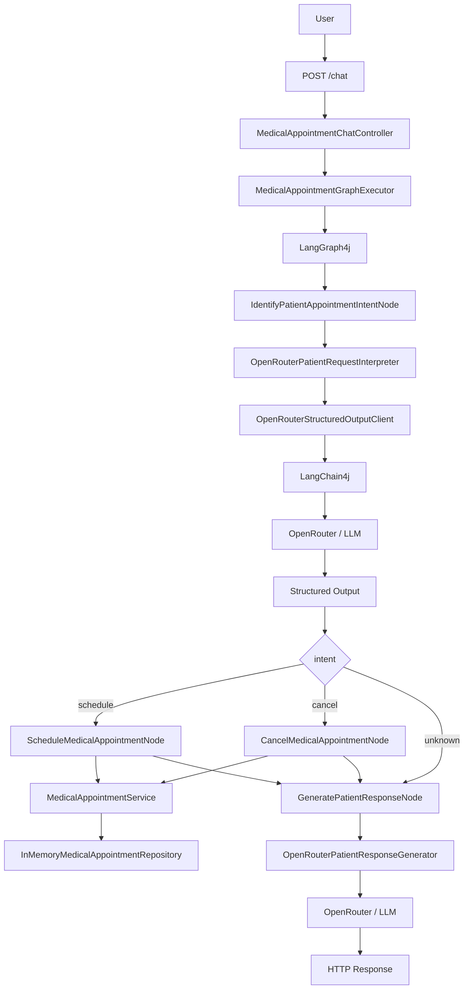
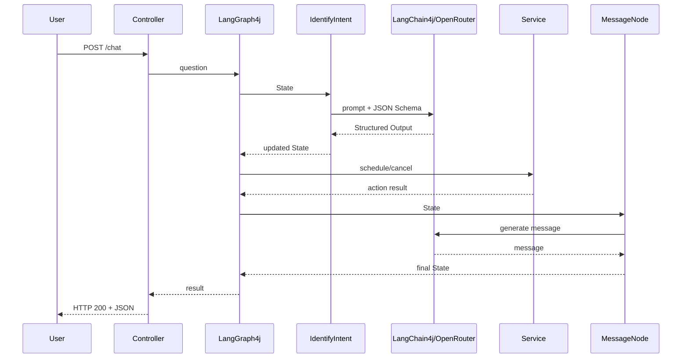

# poc_java_ia_consultamedica

> **Java 21 + Spring Boot + LangChain4j + LangGraph4j + OpenRouter + LangSmith**

Educational project demonstrating how to transform **natural language** into a controlled business action: a user asks to schedule or cancel an appointment, AI extracts intent and structured data, LangGraph4j selects the workflow path, and Java executes the deterministic business rule.

> **Important:** this is a study project using fictional data. Do not use real medical information.

---

## How to use this README

This document has **two purposes**.

### If you want to evaluate or run the project

Read:

1. [Overview](#1-overview)
2. [Architecture](#3-architecture)
3. [Running the project](#11-running-the-project)
4. [REST API](#12-rest-api)
5. [Tests](#14-tests)
6. [Observability](#15-observability)
7. [Limitations](#18-limitations-and-next-steps)

### If you are learning applied AI

Read it from start to finish.

The learning path is:

```text
problem
  ↓
AI concepts
  ↓
Structured Output
  ↓
State / Nodes / Edges
  ↓
real request walkthrough
  ↓
Java code
  ↓
tests
  ↓
reuse the pattern in another domain
```

---

## Project at a glance

| Item | Information |
|---|---|
| **Goal** | demonstrate AI inside a controlled Java workflow |
| **Domain** | fictional appointment scheduling/cancellation |
| **Input** | natural language |
| **AI output** | structured JSON |
| **Workflow** | LangGraph4j |
| **Model access** | OpenRouter |
| **Persistence** | in-memory |
| **Observability** | LangSmith + OpenTelemetry |
| **Main endpoint** | `POST /chat` |
| **Project profile** | educational POC, not production |

### What belongs to AI and what belongs to Java?

```text
AI:
- understand the sentence;
- extract data;
- generate a friendly message.

Java:
- validate preconditions;
- validate professional;
- detect conflicts;
- schedule;
- cancel;
- persist.
```

> **Engineering decision:** the model is not given direct authority to mutate business state. It interprets input; Java decides and executes the operation.

---

## Quick start — run it before studying everything

```bash
# 1. configure
cp .env.example .env

# 2. set OPENROUTER_API_KEY

# 3. local tests
mvn clean test

# 4. start
mvn spring-boot:run
```

Test:

```bash
curl --request POST \
  --url http://localhost:3000/chat \
  --header 'Content-Type: application/json' \
  --data '{
    "question": "My name is Maria Santos and I want an appointment with Dr. Alicio tomorrow at 4 PM"
  }'
```

> **Beginner note:** do not start with LangSmith, OpenTelemetry or Studio. First understand `State → Node → Edge → Service`. Observability comes later.

---

# 1. Overview

## The problem

Java applications work best with well-defined data:

```java
long professionalId = 1L;
String patientName = "Maria Santos";
Instant dateTime = ...;
```

People communicate differently:

```text
Hello, my name is Maria Santos.
I want an appointment with Dr. Alicio tomorrow at 4 PM
for a regular check-up.
```

Before executing a rule, the application needs to discover:

```text
What is the intent?
Which professional?
Which date and time?
Which patient?
What reason?
```

AI is used for that **interpretation step**.

Afterwards, normal Java code takes control.

---

## What the project does

Supported intents:

| Intent | Meaning |
|---|---|
| `schedule` | schedule an appointment |
| `cancel` | cancel an appointment |
| `unknown` | request outside the domain |

Example structured data:

```json
{
  "intent": "schedule",
  "professionalId": 1,
  "professionalName": "Dr. Alicio da Silva",
  "datetime": "2026-10-05T16:00:00Z",
  "patientName": "Maria Santos",
  "reason": null
}
```

AI does **not** persist the appointment.

Java code does.

---

## Architectural principle

> **AI interprets flexible input; Java controls deterministic business rules.**

```text
Natural language
       ↓
      LLM
       ↓
Structured Output
       ↓
LangGraph4j State
       ↓
Routing
       ↓
Java Service
       ↓
Result
       ↓
User message
```

---

# 2. Technologies and responsibilities

| Technology | Responsibility |
|---|---|
| **Java 21** | main language |
| **Spring Boot** | REST API and application configuration |
| **Bean Validation** | HTTP input validation |
| **LangChain4j** | Java-to-LLM integration |
| **OpenRouter** | model gateway |
| **Structured Output / JSON Schema** | defines the expected AI response shape |
| **Jackson** | JSON-to-Java conversion |
| **LangGraph4j** | State, Nodes and Edges workflow |
| **LangGraph4j Studio** | graph visualization and execution |
| **LangSmith** | tracing and observability |
| **OpenTelemetry** | instrumentation and trace export |
| **JUnit** | automated tests |
| **Postman** | manual API testing |

Remember:

```text
Spring       → receives
LangChain4j  → talks to AI
OpenRouter   → provides model access
LangGraph4j  → controls the flow
Java Service → executes business rules
LangSmith    → observes execution
```

---

# 3. Architecture



Graph flow:

```text
START
  ↓
identifyIntent
  ↓
  ├── schedule → schedule ─┐
  ├── cancel   → cancel ───┼→ message → END
  └── unknown ─────────────┘
```


## Request sequence



> **Learning note:** the LLM participates at the beginning and at the end; the actual business mutation happens in ordinary Java code.

---

# 4. AI concepts used by the project

## 4.1 LLM

A Large Language Model processes language.

Here, it is mainly an **interpreter**.

It turns:

```text
I want to cancel tomorrow's appointment with Dr. Ana.
```

into structured fields.

It is not the database, controller or business service.

---

## 4.2 Prompt

A prompt provides:

```text
role
task
rules
context
examples
expected behavior
```

Prompt builders:

```text
MedicalAppointmentIntentPromptBuilder
PatientResponsePromptBuilder
```

---

## 4.3 System Message vs User Message

```text
SystemMessage → how the model should work
UserMessage   → what the model should analyze
```

---

# 5. Structured Output and JSON Schema

Asking:

```text
"Respond in JSON."
```

does not guarantee a clean machine-readable response.

Structured Output provides a formal schema.

Simplified example:

```json
{
  "type": "object",
  "properties": {
    "intent": {
      "enum": ["schedule", "cancel", "unknown"]
    },
    "patientName": {
      "type": "string"
    }
  },
  "required": ["intent"],
  "additionalProperties": false
}
```

Technical flow:

```text
ChatRequest
   +
SystemMessage
   +
UserMessage
   +
ResponseFormat
   +
JsonSchema
       ↓
   OpenRouter
       ↓
Structured JSON
       ↓
  ObjectMapper
       ↓
  Java record
```

Main classes:

```text
MedicalAppointmentStructuredOutputSchemas
OpenRouterStructuredOutputClient
ExtractedMedicalAppointmentIntent
```

LangChain4j documents JSON Schema as the most reliable structured-output approach when the selected model/provider supports it. OpenRouter also supports `response_format` with `json_schema` for compatible endpoints.

---

## Structured Output is not business validation

This can be schema-valid:

```json
{
  "intent": "schedule"
}
```

but still insufficient to schedule.

Therefore:

```text
JSON Schema
   ↓
structure validation

Java validation
   ↓
business preconditions
```

Class:

```text
MedicalAppointmentActionStateValidator
```

---

# 6. LangChain4j and OpenRouter

## LangChain4j

The project uses:

```text
ChatModel
ChatRequest
ChatResponse
SystemMessage
UserMessage
ResponseFormat
JsonSchema
ChatModelListener
```

It prevents the project from having to manually implement every provider HTTP detail.

---

## OpenRouter

Configuration:

```properties
OPENROUTER_API_KEY=...
OPENROUTER_BASE_URL=https://openrouter.ai/api/v1
OPENROUTER_MODEL=...
```

Model configuration lives in:

```text
AiClientConfiguration
```

### Why `require_parameters=true`?

Structured Output is not supported by every provider endpoint.

OpenRouter recommends requiring parameters when the request depends on features such as `response_format/json_schema`, so routing only selects compatible endpoints.

---

# 7. LangGraph4j: State, Nodes and Edges

## 7.1 State

Class:

```text
MedicalAppointmentGraphState
```

Think of State as a **backpack** shared by workflow steps.

Initial:

```json
{
  "messages": [
    "I want an appointment tomorrow at 4 PM."
  ]
}
```

After interpretation:

```json
{
  "messages": ["..."],
  "intent": "schedule",
  "professionalId": 1,
  "datetime": "2026-10-05T16:00:00Z",
  "patientName": "Maria"
}
```

After the action:

```json
{
  "...": "...",
  "actionSuccess": true
}
```

LangGraph4j defines Nodes as units that receive `AgentState`, perform work and return updates to that State.

---

## 7.2 Node

| Node | Responsibility |
|---|---|
| `IdentifyPatientAppointmentIntentNode` | understand intent and extract data |
| `ScheduleMedicalAppointmentNode` | perform scheduling |
| `CancelMedicalAppointmentNode` | perform cancellation |
| `GeneratePatientResponseNode` | generate final user message |

---

## 7.3 Edge

Example:

```text
schedule → message
```

---

## 7.4 Conditional Edge

Class:

```text
RoutePatientRequestByIntent
```

Conceptually:

```text
schedule → schedule
cancel   → cancel
unknown  → message
```

Conditional Edges exist for dynamic routing based on current State.

---

# 8. What each Node does

## IdentifyPatientAppointmentIntentNode

```text
State message
   ↓
PatientRequestInterpreter
   ↓
Structured Output
   ↓
State update
```

It does not schedule anything.

---

## ScheduleMedicalAppointmentNode

```text
validate State
   ↓
parse datetime
   ↓
MedicalAppointmentService
   ↓
update State
```

---

## CancelMedicalAppointmentNode

```text
validate State
   ↓
find appointment
   ↓
cancel
   ↓
update State
```

---

## GeneratePatientResponseNode

Transforms technical state into a friendly message.

A deterministic Java fallback exists if the second AI call fails.

---

# 9. Where AI ends and business logic begins

Business rules live in:

```text
MedicalAppointmentService
```

Schedule:

```text
validate professional
check time conflict
create appointment
save
```

Cancel:

```text
validate professional
find appointment
remove
```

Key design rule:

```text
LLM     → interpretation
Service → business behavior
```

---

# 10. Request walkthrough

Request:

```json
{
  "question": "My name is Maria Santos and I want an appointment with Dr. Alicio tomorrow at 4 PM"
}
```

## Step 1

`MedicalAppointmentChatController` receives HTTP.

## Step 2

`MedicalAppointmentGraphExecutor` initializes:

```json
{
  "messages": ["..."]
}
```

## Step 3

`IdentifyPatientAppointmentIntentNode` executes.

## Step 4

`MedicalAppointmentIntentPromptBuilder` builds context and rules.

## Step 5

`MedicalAppointmentStructuredOutputSchemas` defines the required response shape.

## Step 6

`OpenRouterStructuredOutputClient` sends:

```text
SystemMessage
UserMessage
ResponseFormat
JsonSchema
```

## Step 7

OpenRouter routes the request to the configured model/provider.

## Step 8

JSON becomes `ExtractedMedicalAppointmentIntent`.

## Step 9

The Node updates State.

## Step 10

`RoutePatientRequestByIntent` chooses the next Node.

## Step 11

`MedicalAppointmentActionStateValidator` validates action preconditions.

## Step 12

`MedicalAppointmentService` executes Java business logic.

## Step 13

Action result is stored in State.

## Step 14

`GeneratePatientResponseNode` creates the friendly response.

## Step 15

Spring returns HTTP.

---

# 11. Running the project

Requirements:

```text
JDK 21
Maven 3.9+
```

Check:

```bash
java -version
mvn -version
```

Copy:

```text
.env.example
```

to:

```text
.env
```

Minimal configuration:

```properties
OPENROUTER_API_KEY=your_key
OPENROUTER_MODEL=arcee-ai/trinity-large-preview:free

LANGSMITH_TRACING=false
```

> Model availability and feature support can change. If necessary, configure another model/provider that supports Structured Output.


## Configuration reference

| Variable | Required? | Purpose |
|---|---:|---|
| `OPENROUTER_API_KEY` | yes | OpenRouter authentication |
| `OPENROUTER_BASE_URL` | no | OpenAI-compatible endpoint |
| `OPENROUTER_MODEL` | yes* | selected model |
| `OPENROUTER_TEMPERATURE` | no | generation variability |
| `OPENROUTER_TIMEOUT_SECONDS` | no | provider timeout |
| `OPENROUTER_HTTP_REFERER` | no | optional OpenRouter metadata |
| `OPENROUTER_X_TITLE` | no | optional application name |
| `LANGSMITH_TRACING` | no | enables/disables tracing |
| `LANGSMITH_API_KEY` | if tracing=true | LangSmith authentication |
| `LANGSMITH_PROJECT` | if tracing=true | trace grouping |
| `LANGSMITH_ENDPOINT` | no | LangSmith endpoint |
| `LANGSMITH_INCLUDE_LLM_PAYLOADS` | no | controls LLM payloads in traces |

`*` The project has a default, but keeping it explicit in `.env` improves readability.

> **Technical documentation:** secrets stay outside source code and `.env` must not be committed.

Run tests:

```bash
mvn clean test
```

Start:

```bash
mvn spring-boot:run
```

Server:

```text
http://localhost:3000
```

---

# 12. REST API

## POST `/chat`

Request:

```json
{
  "question": "My name is Maria Santos and I want an appointment with Dr. Alicio tomorrow at 4 PM"
}
```

Validation:

```text
question required
minimum 10 characters
```

cURL:

```bash
curl --request POST \
  --url http://localhost:3000/chat \
  --header 'Content-Type: application/json' \
  --data '{
    "question": "My name is Maria Santos and I want an appointment with Dr. Alicio tomorrow at 4 PM"
  }'
```

Alias:

```text
POST /api/medical-appointments/chat
```

Relevant response fields:

```text
messages
intent
professionalId
professionalName
datetime
patientName
reason
actionSuccess
actionError
error
appointmentData
message
```


### Successful response example

```json
{
  "messages": [
    "My name is Maria Santos and I want an appointment with Dr. Alicio tomorrow at 4 PM",
    "Your appointment was scheduled successfully."
  ],
  "intent": "schedule",
  "professionalId": 1,
  "professionalName": "Dr. Alicio da Silva",
  "datetime": "2026-10-05T16:00:00Z",
  "patientName": "Maria Santos",
  "reason": null,
  "actionSuccess": true,
  "actionError": null,
  "error": null,
  "appointmentData": {
    "professionalId": 1,
    "patientName": "Maria Santos"
  },
  "message": "Your appointment was scheduled successfully."
}
```

> **Note:** generated message wording can vary. Business fields and routing are better targets for deterministic assertions.

---

# 13. Demo data

Professionals are provided by:

```text
MedicalProfessionalDirectory
```

Appointments are stored by:

```text
InMemoryMedicalAppointmentRepository
```

Runtime changes are lost after application restart.

This is intentional: the POC focuses on AI and workflow rather than persistence.

---

# 14. Tests

## Expected behaviors

| Scenario | Expected result |
|---|---|
| valid scheduling request | `intent=schedule` and action executed |
| occupied time slot | `actionSuccess=false` with `actionError` |
| existing appointment cancellation | `intent=cancel` and appointment removed |
| missing appointment cancellation | business error, not parsing error |
| request outside domain | `intent=unknown` and no business mutation |
| final-message AI failure | Java fallback |
| local/unit test | does not require an external LLM by default |

> **Learning note:** in AI systems, test deterministic behavior separately from probabilistic model behavior.


## Business tests

```text
MedicalAppointmentServiceTest
```

## Graph tests

```text
MedicalAppointmentGraphFlowTest
```

These can validate routing without depending on a real external LLM.

## Real E2E

```text
OpenRouterMedicalAppointmentE2ETest
```

Run explicitly:

```bash
mvn -DrunOpenRouterE2E=true \
    -Dtest=OpenRouterMedicalAppointmentE2ETest \
    test
```

External requirements:

```text
network
valid API key
model availability
compatible provider endpoint
```

---

# 15. Observability

## LangGraph4j Studio

Open:

```text
http://localhost:3000/?instance=medical_appointments
```

Use Studio to inspect:

```text
START
  ↓
identifyIntent
  ↓
schedule / cancel / message
  ↓
message
  ↓
END
```

---

## LangSmith

Configuration:

```properties
LANGSMITH_API_KEY=your_key
LANGSMITH_TRACING=true
LANGSMITH_PROJECT=poc-java-ia-consultamedica
LANGSMITH_ENDPOINT=https://api.smith.langchain.com
```

Conceptually:

```text
LangGraph4j / LangChain4j
        ↓
OpenTelemetry
        ↓
LangSmith
```

Expected trace shape:

```text
medical_appointments
├── identifyIntent
│   └── openrouter.chat
├── schedule or cancel
└── message
    └── openrouter.chat
```

For initial learning, keep:

```properties
LANGSMITH_TRACING=false
```

until the main workflow is understood.

---

# 16. Code structure

```text
src/main/java/.../
├── api/
├── ai/
│   ├── prompt/
│   └── schema/
├── graph/
│   ├── node/
│   ├── route/
│   └── validation/
├── service/
├── repository/
├── config/
└── observability/
```

---

# 17. Guided learning path

## Stage 1 — HTTP

```text
MedicalAppointmentChatController
MedicalAppointmentChatRequest
MedicalAppointmentChatResponse
```

Question:

> How does data enter and leave?

## Stage 2 — Graph

```text
MedicalAppointmentGraphExecutor
MedicalAppointmentGraphConfiguration
MedicalAppointmentGraphState
```

Question:

> Where does workflow execution start and where is context stored?

## Stage 3 — AI input

```text
IdentifyPatientAppointmentIntentNode
OpenRouterPatientRequestInterpreter
MedicalAppointmentIntentPromptBuilder
MedicalAppointmentStructuredOutputSchemas
OpenRouterStructuredOutputClient
```

Question:

> How does a String become a typed Java object?

## Stage 4 — Routing

```text
RoutePatientRequestByIntent
```

Question:

> How does intent change the path?

## Stage 5 — Business

```text
MedicalAppointmentActionStateValidator
ScheduleMedicalAppointmentNode
CancelMedicalAppointmentNode
MedicalAppointmentService
InMemoryMedicalAppointmentRepository
```

Question:

> Where does AI interpretation stop and deterministic Java begin?

## Stage 6 — Output

```text
GeneratePatientResponseNode
OpenRouterPatientResponseGenerator
PatientResponsePromptBuilder
```

## Stage 7 — Observability

```text
LangGraphStudioConfiguration
LangSmithOpenTelemetryConfiguration
LangGraphTracingConfiguration
LangSmithChatModelTraceListener
```

---

# 18. Limitations and next steps

Not implemented:

```text
authentication
authorization
persistent database
production privacy controls
complete timezone handling
idempotency
distributed concurrency
circuit breaker
production retry strategy
human confirmation
persistent chat memory
```

Possible next steps:

1. add `check_availability`;
2. add confirmation before cancellation;
3. replace in-memory storage with PostgreSQL;
4. add appointment IDs;
5. add explicit timezone handling;
6. add model fallback;
7. add metrics;
8. add structured-output evaluations.

---

## What would be required for production?

This POC is intentionally smaller than a real production system.

At minimum, a production design should evaluate:

```text
transactional persistence
authentication and authorization
privacy/redaction
patient/clinic timezone
idempotency
appointment concurrency/locking
retry and circuit breaker
rate limiting
metrics and alerts
auditing
confirmation for destructive actions
LLM quality evaluation
provider/model fallback
```

> **Scope decision:** these concerns are intentionally outside this POC so the learning focus stays on the AI/workflow pattern.

---

# 19. Troubleshooting

## Missing OpenRouter key

Check `.env`:

```properties
OPENROUTER_API_KEY=...
```

## Structured Output error

Verify that the selected model/provider endpoint supports `response_format/json_schema`.

## Correct intent, failed action

Structured extraction can be valid while business preconditions are incomplete.

## Appointments disappear after restart

Expected: storage is in memory.

## No LangSmith trace

Check:

```properties
LANGSMITH_TRACING=true
LANGSMITH_API_KEY=...
LANGSMITH_PROJECT=...
```

---

# 20. Reusing the pattern in another domain

Example: technical support.

## Step 1 — define input

```text
My application will not start. I want to open a ticket.
```

## Step 2 — define intents

```text
open_ticket
close_ticket
unknown
```

## Step 3 — define Structured Output

```json
{
  "intent": "open_ticket",
  "customerName": "Maria",
  "category": "system_error",
  "description": "Application does not start"
}
```

## Step 4 — create Java type

```java
record ExtractedSupportIntent(
        String intent,
        String customerName,
        String category,
        String description
) {
}
```

## Step 5 — create JSON Schema

Define types, required fields and enums.

## Step 6 — prove extraction first

```text
String → LLM → structured record
```

before adding a graph.

## Step 7 — define State

```text
messages
intent
customerName
category
description
actionSuccess
actionError
```

## Step 8 — define Nodes

```text
identifyIntent
openTicket
closeTicket
generateMessage
```

## Step 9 — draw the graph

```text
START
  ↓
identifyIntent
  ├─ open_ticket  → openTicket  ┐
  ├─ close_ticket → closeTicket ├→ message → END
  └─ unknown ───────────────────┘
```

## Step 10 — create Java Service

```java
SupportTicketService.openTicket(...)
SupportTicketService.closeTicket(...)
```

## Step 11 — test without a real LLM

## Step 12 — add real E2E

## Step 13 — add observability last

If you can reproduce these steps in another domain, the knowledge has transferred.

---

# 21. Exercises

## Level 1

Explain:

1. Who receives HTTP?
2. Where is State?
3. Who calls the model?
4. Where is JSON Schema?
5. Who routes schedule/cancel?
6. Which class really schedules?
7. What is LangSmith for?

## Level 2

Add another professional.

## Level 3

Implement:

```text
check_availability
```

Consider:

```text
enum
schema
prompt
router
node
service
tests
```

## Level 4

Create a new POC in another domain without copying entire classes.

---

# 22. Lesson-to-code mapping

| Lesson | Concepts | Java location |
|---|---|---|
| Module 03-01 | intent, State, Nodes, Edges | `graph/` |
| Module 03-02 | JSON Prompt, Structured Output, OpenRouter | `ai/`, `prompt/`, `schema/` |
| Module 03-03 | text → JSON → State → routing | `IdentifyPatientAppointmentIntentNode` |
| Module 03-04 | actions, validation, E2E, Studio, tracing | `node/`, `service/`, `observability/` |

Detailed migration:

```text
docs/ANALISE_MIGRACAO.md
```

Technical validation:

```text
docs/VALIDACAO_FINAL.md
```

---

# 23. Design decisions

## Why in-memory storage?

To reduce simultaneous concepts and keep focus on AI/workflow.

## Why AI interfaces?

To test without an external dependency.

## Why LangGraph4j instead of only `if/else`?

To learn an explicit workflow model that can grow.

## Why not let AI directly execute the Service?

Business actions should remain predictable, testable and auditable.

## Why two model calls?

One specializes in **understanding**; the other in **communicating the result**.

---

# 24. Security and privacy

Never commit:

```text
.env
OPENROUTER_API_KEY
LANGSMITH_API_KEY
```

Tracing may record State, prompts or outputs depending on configuration.

Do not use real medical data.

---

# 25. Learning checklist

Explain without looking:

```text
[ ] LLM
[ ] Prompt
[ ] SystemMessage
[ ] UserMessage
[ ] Structured Output
[ ] JSON Schema
[ ] LangChain4j
[ ] OpenRouter
[ ] State
[ ] Node
[ ] Edge
[ ] Conditional Edge
[ ] LangGraph4j
[ ] Service
[ ] second validation
[ ] fallback
[ ] Studio
[ ] LangSmith
[ ] OpenTelemetry
[ ] how to build another POC
```

---

# 26. 30-second summary

```text
1. Spring receives a sentence.
2. LangChain4j sends it to the model via OpenRouter.
3. The model returns Structured Output.
4. Data enters State.
5. LangGraph4j selects the next Node.
6. Java executes the business rule.
7. The result returns to State.
8. AI generates a friendly message.
9. Spring returns HTTP.
10. LangSmith can record the trace.
```

Main lesson:

> **Use AI where language is ambiguous. Use Java where business control must be deterministic.**

---

# Official references

- LangChain4j — https://docs.langchain4j.dev/
- Structured Outputs — https://docs.langchain4j.dev/tutorials/structured-outputs/
- LangGraph4j — https://langgraph4j.github.io/langgraph4j/
- OpenRouter — https://openrouter.ai/docs
- OpenRouter Structured Outputs — https://openrouter.ai/docs/guides/features/structured-outputs
- LangSmith — https://docs.langchain.com/langsmith/
- OpenTelemetry Java — https://opentelemetry.io/docs/languages/java/
- Spring Boot — https://spring.io/projects/spring-boot
