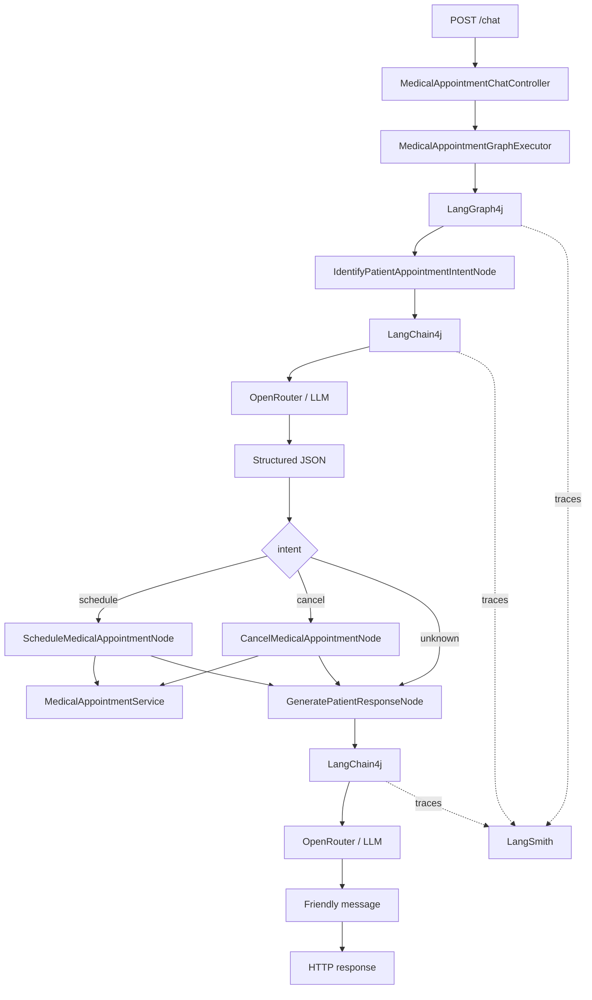

# poc_java_ia_consultamedica

A learning-oriented **Java 21 + Spring Boot** proof of concept for understanding an AI workflow that schedules and cancels fictional medical appointments.

This is a migration of the JavaScript/TypeScript **Module 03** sample into Java. It is intentionally written for a software developer who is still learning AI concepts.

> **Important:** this is a study project. Do not use real medical data.

---

## 1. What am I learning?

The central idea is to transform a human sentence:

```text
My name is Maria Santos.
I want an appointment with Dr. Alicio da Silva tomorrow at 4 PM
for a check-up.
```

into predictable application data:

```json
{
  "intent": "schedule",
  "professionalId": 1,
  "professionalName": "Dr. Alicio da Silva",
  "datetime": "2026-10-04T16:00:00Z",
  "patientName": "Maria Santos",
  "reason": "check-up"
}
```

The application flow is:

```text
natural language
      ↓
      AI
      ↓
structured JSON
      ↓
LangGraph4j State
      ↓
Java business rule
      ↓
technical result
      ↓
      AI
      ↓
friendly message
```

---

# 2. Technologies

- Java 21
- Spring Boot 3.5.16
- Maven
- LangChain4j 1.20.2
- LangGraph4j 1.9.3
- LangGraph4j Studio
- OpenRouter
- LangSmith
- OpenTelemetry
- Jackson
- Bean Validation
- JUnit 5
- Postman

---

# 3. Architecture



---

# 4. What does AI do here?

AI is used mainly to:

1. interpret the patient's natural-language request;
2. generate the final friendly message.

It does **not** directly create or delete appointments.

The actual business action is Java code:

```text
MedicalAppointmentService
```

This keeps the rule explicit and testable.

---

# 5. OpenRouter vs LangSmith vs LangGraph

| Tool | Purpose |
|---|---|
| OpenRouter | Access/run the AI model |
| LangChain4j | Java integration with the model |
| LangGraph4j | Workflow/state/nodes/edges |
| LangGraph4j Studio | Local graph visualization/execution |
| LangSmith | Tracing and observability |
| OpenTelemetry | Sends trace spans to LangSmith |

`OPENROUTER_API_KEY` and `LANGSMITH_API_KEY` therefore serve different purposes.

---

# 6. Why did the original project have LANGSMITH_API_KEY?

The original `.env.example` contains:

```properties
LANGSMITH_API_KEY=your_langsmith_api_key_here
LANGCHAIN_TRACING_V2=true
LANGCHAIN_PROJECT=03-medical-appointment
```

Those values are related to **tracing**, not model execution.

The Java version preserves that goal using:

```text
LangGraph4j hooks
   ↓
OpenTelemetry
   ↓
LangSmith
```

and:

```text
LangChain4j ChatModelListener
   ↓
OpenTelemetry
   ↓
LangSmith
```

---

# 7. LangSmith configuration

```properties
LANGSMITH_API_KEY=your_langsmith_api_key_here
LANGSMITH_TRACING=true
LANGSMITH_PROJECT=poc-java-ia-consultamedica
LANGSMITH_ENDPOINT=https://api.smith.langchain.com
LANGSMITH_INCLUDE_LLM_PAYLOADS=true
```

Expected trace shape:

```text
medical_appointments
├── identifyIntent
│   └── openrouter.chat
├── schedule or cancel
└── message
    └── openrouter.chat
```

The project also supports the old sample variable names as fallbacks:

```properties
LANGCHAIN_TRACING_V2=true
LANGCHAIN_PROJECT=03-medical-appointment
```

---

# 8. LangGraph4j Studio

Start the application and open:

```text
http://localhost:3000/?instance=medical_appointments
```

Input argument:

```text
messages
```

The Studio field accepts one sentence and the Java configuration converts it to `List<String>`, preserving the source GraphState `messages` concept.

Studio is for local graph visualization and execution.

LangSmith is for tracing and observability.

They are complementary.

---

# 9. Structured Output

The application does not rely on asking the model to merely "please output JSON".

It sends a JSON Schema using LangChain4j:

```text
ChatRequest
+
ResponseFormat
+
JsonSchema
      ↓
OpenRouter
      ↓
structured JSON
      ↓
Jackson
      ↓
Java record
```

Main class:

```text
OpenRouterStructuredOutputClient
```

Schemas:

```text
MedicalAppointmentStructuredOutputSchemas
```

---

# 10. What replaced Zod?

The JavaScript project uses Zod.

In Java, the equivalent responsibility is implemented with:

```text
LangChain4j JsonSchema
Java records
Bean Validation
State validation before actions
```

---

# 11. Why is there no literal createAgent copy?

The JavaScript lesson uses `createAgent` as part of its structured-output implementation.

The Java version uses:

```text
ChatModel
ChatRequest
ResponseFormat
JsonSchema
```

The concept is preserved without introducing an unnecessary "agent" merely to copy an API name.

---

# 12. LangGraph4j State

Class:

```text
MedicalAppointmentGraphState
```

Think of State as shared data traveling through the graph.

Initial:

```json
{
  "messages": [
    "I want an appointment..."
  ]
}
```

After intent identification:

```json
{
  "messages": ["I want an appointment..."],
  "intent": "schedule",
  "professionalId": 1,
  "professionalName": "Dr. Alicio da Silva",
  "appointmentDateTime": "...",
  "patientName": "Maria Santos"
}
```

---


## Why does `messages` exist?

The TypeScript source starts the graph with:

```text
messages: [HumanMessage(question)]
```

and the final node appends the AI response to that history.

The Java version preserves this idea with:

```java
List<String>
```

rather than provider-specific `BaseMessage` objects.

This keeps the graph State simple while retaining the lesson's message-history concept.

At the end of one request:

```json
[
  "I want an appointment tomorrow at 4 PM.",
  "Your appointment was scheduled successfully."
]
```

This POC is still **single-turn per HTTP request**. It does not implement persistent conversation memory.

# 13. Nodes

- `IdentifyPatientAppointmentIntentNode`
- `ScheduleMedicalAppointmentNode`
- `CancelMedicalAppointmentNode`
- `GeneratePatientResponseNode`

Flow:

```text
START
  ↓
identifyIntent
  ↓
  ├── schedule → message → END
  ├── cancel   → message → END
  └── message  → END
```

The conditional route is implemented by:

```text
RoutePatientRequestByIntent
```

---

# 14. Second validation

Even after Structured Output, action nodes validate required fields again.

Class:

```text
MedicalAppointmentActionStateValidator
```

This preserves the lesson's "trust, but verify" idea.

---

# 15. In-memory data

Professionals:

| ID | Name | Specialty |
|---:|---|---|
| 1 | Dr. Alicio da Silva | Cardiology |
| 2 | Dra. Ana Pereira | Dermatology |
| 3 | Dra. Carol Gomes | Neurology |

The repository also starts with two fictional appointments, matching the source project.

Persistence class:

```text
InMemoryMedicalAppointmentRepository
```

Restarting the application resets runtime changes.

---

# 16. Project structure

```text
poc_java_ia_consultamedica/
├── .env.example
├── pom.xml
├── README.md
├── README_EN.md
├── docs/
│   └── ANALISE_MIGRACAO.md
├── postman/
│   └── poc_java_ia_consultamedica.postman_collection.json
└── src/
    ├── main/
    └── test/
```

---

# 17. Requirements

```text
JDK 21
Maven 3.9+
```

Check:

```bash
java -version
mvn -version
```

---

# 18. Environment configuration

Copy:

```text
.env.example
```

to:

```text
.env
```

Minimum setup:

```properties
OPENROUTER_API_KEY=your_key
LANGSMITH_TRACING=false
```

Full setup:

```properties
OPENROUTER_API_KEY=your_openrouter_key
OPENROUTER_MODEL=arcee-ai/trinity-large-preview:free
OPENROUTER_TEMPERATURE=0.7

LANGSMITH_API_KEY=your_langsmith_key
LANGSMITH_TRACING=true
LANGSMITH_PROJECT=poc-java-ia-consultamedica
LANGSMITH_ENDPOINT=https://api.smith.langchain.com
LANGSMITH_INCLUDE_LLM_PAYLOADS=true
```

---

# 19. Tests

Local deterministic tests:

```bash
mvn clean test
```

The real OpenRouter E2E test requires explicit opt-in:

```bash
mvn -DrunOpenRouterE2E=true \
    -Dtest=OpenRouterMedicalAppointmentE2ETest \
    test
```

and:

```text
OPENROUTER_API_KEY
```

must be available.

---

# 20. Running

```bash
mvn spring-boot:run
```

Server:

```text
http://localhost:3000
```

---

# 21. REST endpoint

The original endpoint is preserved:

```text
POST /chat
```

Body:

```json
{
  "question": "My name is Maria Santos and I want an appointment with Dr. Alicio da Silva tomorrow at 4 PM"
}
```

An additional descriptive alias exists:

```text
POST /api/medical-appointments/chat
```

---

# 22. Postman

Collection:

```text
postman/poc_java_ia_consultamedica.postman_collection.json
```

It contains seven scenarios:

1. successful schedule;
2. unavailable slot;
3. create appointment for cancellation;
4. cancel the created appointment;
5. cancellation not found;
6. unknown intent;
7. descriptive REST alias.

---

# 23. Lesson mapping

## MODULE 03 - 01

Topics:

- natural language;
- intent;
- State;
- nodes;
- conditional edges;
- schedule/cancel/unknown;
- in-memory service.

Java:

```text
MedicalAppointmentGraphState
MedicalAppointmentGraphConfiguration
MedicalAppointmentIntent
MedicalProfessionalDirectory
InMemoryMedicalAppointmentRepository
```

## MODULE 03 - 02

Topics:

- Structured JSON;
- JSON prompts;
- OpenRouter;
- schema;
- model configuration.

Java:

```text
AiClientConfiguration
MedicalAppointmentStructuredOutputSchemas
OpenRouterStructuredOutputClient
MedicalAppointmentIntentPromptBuilder
```

## MODULE 03 - 03

Topics:

```text
question -> prompt -> model -> JSON -> State -> routing
```

Java:

```text
IdentifyPatientAppointmentIntentNode
RoutePatientRequestByIntent
MedicalAppointmentGraphExecutor
MedicalAppointmentChatController
MedicalAppointmentGraphFlowTest
OpenRouterMedicalAppointmentE2ETest
```

## MODULE 03 - 04

Topics:

- secondary validation;
- scheduling;
- cancellation;
- final message;
- E2E;
- Studio;
- Trace.

Java:

```text
MedicalAppointmentActionStateValidator
ScheduleMedicalAppointmentNode
CancelMedicalAppointmentNode
GeneratePatientResponseNode
LangGraphStudioConfiguration
LangGraphTracingConfiguration
LangSmithOpenTelemetryConfiguration
LangSmithChatModelTraceListener
```

---

# 24. JavaScript → Java mapping

| JavaScript | Java |
|---|---|
| `server.ts` | `MedicalAppointmentChatController` |
| `graph.ts` | `MedicalAppointmentGraphState` |
| `factory.ts` | `MedicalAppointmentGraphConfiguration` |
| `identifyIntentNode.ts` | `IdentifyPatientAppointmentIntentNode` |
| `schedulerNode.ts` | `ScheduleMedicalAppointmentNode` |
| `cancellerNode.ts` | `CancelMedicalAppointmentNode` |
| `messageGeneratorNode.ts` | `GeneratePatientResponseNode` |
| `appointmentService.ts` | `MedicalAppointmentService` + Repository |
| `openRouterService.ts` | `OpenRouterStructuredOutputClient` |
| Zod | LangChain4j JsonSchema |
| LangChain JS | LangChain4j |
| LangGraph JS | LangGraph4j |
| Studio | LangGraph4j Studio |
| LangChain tracing | OpenTelemetry + LangSmith |

---

# 25. Intent-revealing names

Examples:

```java
interpretPatientRequest(...)
processPatientQuestion(...)
scheduleMedicalAppointment(...)
cancelMedicalAppointment(...)
findMissingRequiredFields(...)
generatePatientResponse(...)
```

The code intentionally avoids vague names where a more descriptive name is possible.

---

# 26. Source corrections

The migration does not intentionally preserve source defects.

Corrections include:

- stale README content from another project;
- an error path that could report success;
- inconsistent error fields;
- final-language prompt without the original patient question.

---

# 27. Privacy

This is a learning project with fictional data.

Do not use real medical information.

When tracing is enabled, State information and optionally LLM prompts/outputs can be sent to observability.

For a real system, implement redaction and privacy controls.

---

# 28. Migration audit

Read:

```text
docs/ANALISE_MIGRACAO.md
```

It contains the final checklist comparing:

```text
original JavaScript project
+
four lesson transcripts
+
Java migration
```

---

# 29. Summary

The project can be summarized as:

```text
human sentence
   ↓
LLM
   ↓
Structured JSON
   ↓
LangGraph4j State
   ↓
conditional routing
   ↓
Java business rule
   ↓
State
   ↓
LLM
   ↓
friendly message
```

Observability:

```text
graph + LLM calls
      ↓
OpenTelemetry
      ↓
LangSmith
```

The core idea is:

> **Use AI to understand flexible human input, while Java keeps control of deterministic business behavior.**

---

# Technical references

- LangChain4j: https://docs.langchain4j.dev/
- Structured Outputs: https://docs.langchain4j.dev/tutorials/structured-outputs/
- LangGraph4j: https://github.com/langgraph4j/langgraph4j
- OpenRouter: https://openrouter.ai/docs
- LangSmith: https://docs.langchain.com/langsmith/
- OpenTelemetry Java: https://opentelemetry.io/docs/languages/java/
- Spring Boot: https://spring.io/projects/spring-boot
